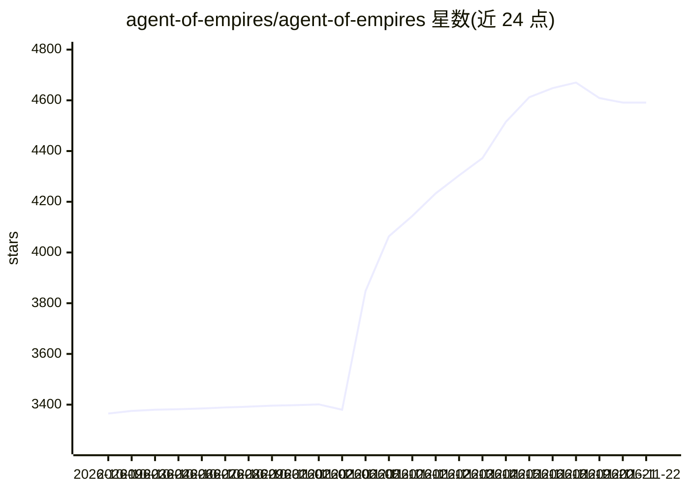

# agent-of-empires/agent-of-empires

⭐ 4,591 · Rust · MIT · 推送 2026-11-21 · [GitHub](https://github.com/agent-of-empires/agent-of-empires) · [官网](http://www.agent-of-empires.com/) · 组织维护

**多 AI 编码 agent 的会话管理器：TUI/Web 并行监控**

面向 Linux 与 macOS 的 AI 编码 agent 会话管理工具。每个 agent 运行在独立 tmux 会话中，支持跨分支并行运行、Git worktree 与容器隔离（Docker/Podman/Apple Containers）、状态检测与通知，并提供 TUI、Web、CLI 与 HTTP API 四种访问界面，Web 端可从手机浏览器访问。通过 brew 或安装脚本安装，需 tmux，Windows 仅支持 WSL2。

## 筛选速览

| 维度 | 判定 | 备注 |
|---|---|---|
| AI 角色 | `ai-ecosystem` | LLM/agent 周边工具 |
| 许可风险 | `permissive` | MIT |
| 部署形态 | `None` |  |
| 模型依赖 | — | README 未给出锁定关系 |
| 硬件要求 | — | 无带数字的原话,不猜 |
| 安装摩擦 | `low` | 无编译、无系统依赖或容器化 |
| 成熟度 | — | 结构信号不足 |

## 能力要点

- 每个 agent 独立 tmux 会话，SSH 断开后持续运行
- TUI/Web/CLI/HTTP API 多种访问界面，Web 支持手机访问
- Git worktree、多仓库工作区与容器沙箱隔离
- 支持 Claude Code、Codex CLI、Gemini CLI 等多种 agent

## 适用场景

- 同时并行管理多个分支上的 AI 编码 agent 会话
- 通过手机浏览器远程查看和监控 agent 状态
- 用容器沙箱隔离运行 agent 的环境

## 场景标签

`编码 Agent` · 领域:编码与开发

## 证据(README 行号)

> L20: A session manager for AI coding agents on Linux and macOS. Run agents in
> L41: - Docker, Podman, and Apple Containers sandboxing
> L55: Requires tmux on Linux or macOS.

## 星数曲线

2026-10-19 3,365 → 2026-11-22 4,591（+1,226）

---
*卡片 v1 · prompt 1.4 · 生成 2026-11-22 · 置信度 high · 依据 README sha `f263d49a8bb9` · [字段定义](../../DATASET.md)*
