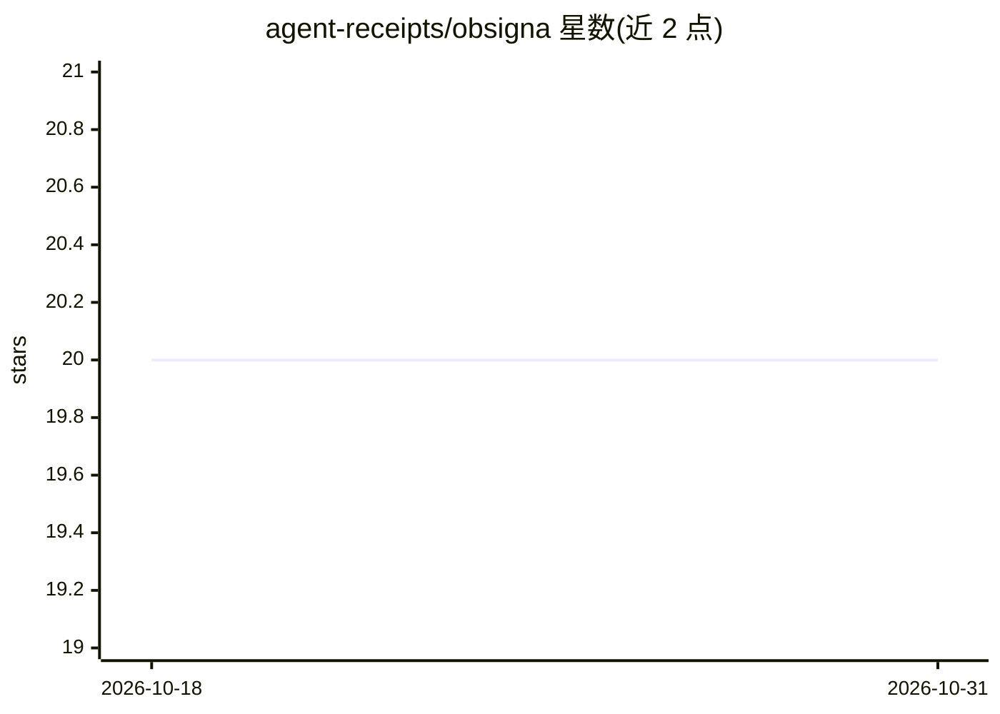

# agent-receipts/obsigna

⭐ 20 · Go · Apache-2.0 · 推送 2026-10-30 · [GitHub](https://github.com/agent-receipts/obsigna) · [官网](https://agentreceipts.ai) · 组织维护

**AI agent 操作的密码学签名审计协议与工具集**

定义 Agent Receipts 开放协议：对 AI agent 的每次动作生成 Ed25519 签名、防篡改的链式收据，含收据格式、签名方案与动作类型分类。Obsigna 为参考实现，提供 MCP stdio 代理（签名每次工具调用）、持有密钥的进程外签名守护进程、Claude Code PostToolUse hook、CLI 及 Go/TypeScript/Python 三套独立 SDK。三 SDK 交叉验证收据，协议链不可篡改性用 Alloy 有界模型检验。给需要 agent 行为可审计与可验证的开发者使用。

## 筛选速览

| 维度 | 判定 | 备注 |
|---|---|---|
| AI 角色 | `ai-ecosystem` | LLM/agent 周边工具 |
| 许可风险 | `permissive` | Apache-2.0 |
| 部署形态 | `library` | 以包/库形式分发 |
| 模型依赖 | locked-api |  |
| 硬件要求 | — | 无带数字的原话,不猜 |
| 安装摩擦 | `low` | 无编译、无系统依赖或容器化 |
| 成熟度 | — | 结构信号不足 |

## 能力要点

- Ed25519 签名的链式收据，防篡改审计轨迹
- MCP 代理、签名守护进程、Claude Code hook 与三语言 SDK
- 三套独立 SDK 交叉验证收据，CI 强制一致性
- Alloy 形式化模型检验链完整性（含明示的截断残余边界）

## 适用场景

- 为 agent 的每次工具调用生成可验证的签名收据
- 审计并核验 AI agent 操作记录是否被篡改
- 通过 MCP 代理在收据之上附加策略钩子与风险评分

## 场景标签

`网络安全` `LLM 可观测性` · 领域:评测与运维

## 证据(README 行号)

> L28: **Agent Receipts** is an open protocol for producing cryptographically signed, tamper-evident records of AI agent a
> L34: |`obsigna-mcp`|MCP stdio proxy — signs every tool call, adds policy hooks|

## 星数曲线

2026-10-18 20 → 2026-10-31 20（+0）

---
*卡片 v1 · prompt 1.4 · 生成 2026-10-28 · 置信度 high · 依据 README sha `f9ed61f88520` · [字段定义](../../DATASET.md)*
