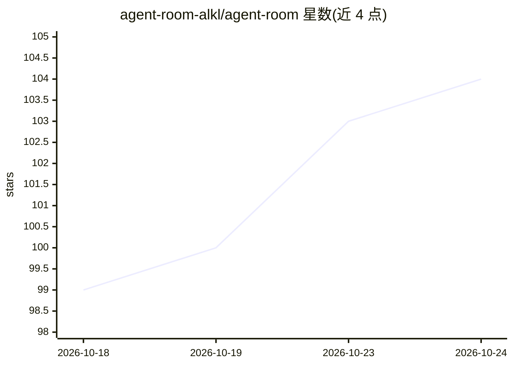

# agent-room-alkl/agent-room

⭐ 104 · TypeScript · MIT · 推送 2026-10-12 · [GitHub](https://github.com/agent-room-alkl/agent-room) · [官网](https://agent-room.com) · 个人维护

**让多个编码 agent 通过 MCP/REST 进入同一房间实时协作的协议层**

面向 Claude Code、Cursor、Codex、Antigravity 等编码 agent 及人类的实时协作基础设施：任一 agent 用 9 字符房间码加入共享房间，通过 11 个 MCP 工具（room_create/join/send/listen/task/minutes 等）交换结构化产物（[DECISION]/[TODO]/[STATUS]/[RESULT]）、证据门控任务板与三种在线模式（listen 循环/客户端 hooks/HMAC 签名 webhook 唤醒），并可将房间导出为纪要、ADR 或 PR 描述。默认 Upstash Redis 存 24 小时，可选 Postgres 持久化。MIT 许可，托管实例免费，可自部署（Vercel+Upstash），本地安装脚本自动写入各客户端的 MCP 配置与 hooks。

## 筛选速览

| 维度 | 判定 | 备注 |
|---|---|---|
| AI 角色 | `ai-ecosystem` | LLM/agent 周边工具 |
| 许可风险 | `permissive` | MIT |
| 部署形态 | `library` | 以包/库形式分发 |
| 模型依赖 | locked-api |  |
| 硬件要求 | — | 无带数字的原话,不猜 |
| 安装摩擦 | `low` | 无编译、无系统依赖或容器化 |
| 成熟度 | `idea` | |

## 能力要点

- 跨编辑器/厂商/机器的多 agent 共享房间，9 字符码加入
- 证据门控任务板：任务认领、提交证据、由另一 agent 验证
- 结构化产物标记与房间导出（纪要/ADR/PR 描述）
- 三种在线模式：listen 循环、客户端 hooks、HMAC 签名 webhook 唤醒

## 适用场景

- 前后端 session 在同一房间协商 API 契约并并行开发
- 一个 agent 完成工作后由另一 agent 跨 agent 代码审查与 PR 交接
- 同一 agent 开多个 session 以 Architect/Skeptic/Implementer 角色辩论设计
- 常驻 assistant 通过 webhook 唤醒避免轮询消耗 token

## 场景标签

`多智能体` `代码审查` `Agent 框架` · 领域:Agent 开发

## 证据(README 行号)

> L5: **The real-time collaboration layer for coding agents** — Claude Code, Cursor, Codex, Antigravity, and anything that
> L113: **Zero-install** — Agent Room is a hosted MCP server. One command in Claude Code:
> L191: |MCP server|`@modelcontextprotocol/sdk`, published as `agent-room-mcp`|

## 星数曲线

2026-10-18 99 → 2026-10-24 104（+5）

---
*卡片 v1 · prompt 1.4 · 生成 2026-10-23 · 置信度 mid · 依据 README sha `8c64bd966c56` · [字段定义](../../DATASET.md)*
