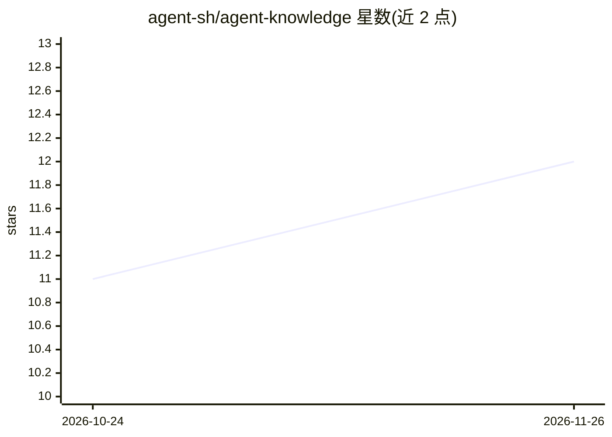

# agent-sh/agent-knowledge

⭐ 12 · Shell · 推送 2026-10-31 · [GitHub](https://github.com/agent-sh/agent-knowledge) · 组织维护

**面向 AI Agent 开发的研究指南与 RAG 索引合集**

由 agentsys 的 `/learn` 命令生成的知识库仓库，收录约 28 个主题指南，覆盖 AI CLI 集成、技能/插件分发、浏览器自动化、各类平台认证流程、Git 历史分析、消息队列 API 参考等。通过 `AGENTS.md` 索引将触发短语映射到对应指南文件，供 AI 工具在 RAG 流程中检索引用；多数指南附 `resources/` 下的来源元数据 JSON，含质量评分、URL 与要点。仓库不包含可执行程序，无安装步骤。

## 筛选速览

| 维度 | 判定 | 备注 |
|---|---|---|
| AI 角色 | `ai-knowledge` | 知识聚合/清单类 |
| 许可风险 | `none` | — |
| 部署形态 | `None` |  |
| 模型依赖 | — | README 未给出锁定关系 |
| 硬件要求 | — | 无带数字的原话,不猜 |
| 安装摩擦 | `low` | 无编译、无系统依赖或容器化 |
| 成熟度 | — | 结构信号不足 |

## 能力要点

- AGENTS.md 索引提供触发短语与关键词查找，映射到指南文件
- 约 28 个主题指南，覆盖 Agent 集成、认证流程、工具分发等
- 多数指南附来源元数据 JSON（质量评分、URL、要点）

## 适用场景

- 为 AI Agent 开发工具提供可检索的知识库素材
- 查阅浏览器 Agent 的各类平台认证流程
- 按 AGENTS.md 触发短语定位对应主题指南

## 场景标签

`RAG` `教程课程` · 领域:知识与检索

## 证据(README 行号)

> L3: Research guides and RAG indexes for AI agent development. Generated by agentsys `/learn` command.
> L42: These guides are designed for RAG (Retrieval-Augmented Generation). AI tools can reference them via `AGENTS.md` ind

## 星数曲线

2026-10-24 11 → 2026-11-26 12（+1）

---
*卡片 v1 · prompt 1.4 · 生成 2026-11-18 · 置信度 high · 依据 README sha `f0f8c9300c7e` · [字段定义](../../DATASET.md)*
