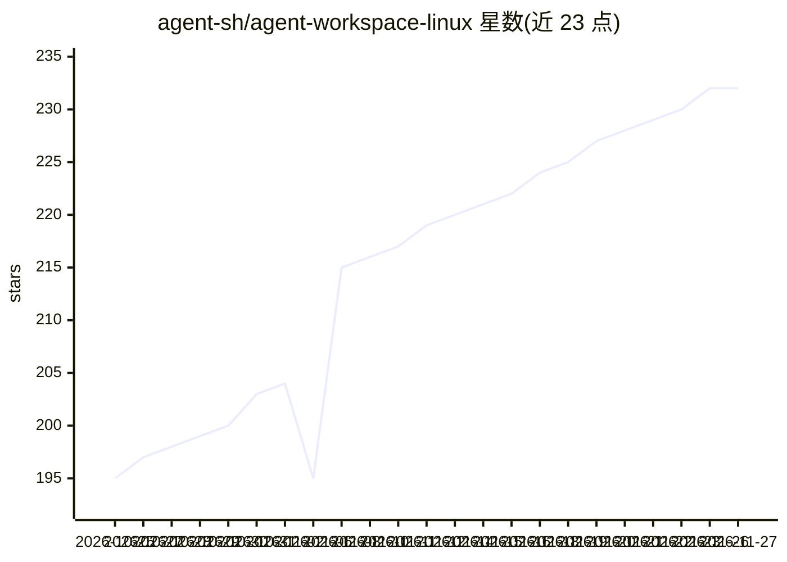

# agent-sh/agent-workspace-linux

⭐ 232 · Rust · MIT · 推送 2026-11-26 · [GitHub](https://github.com/agent-sh/agent-workspace-linux) · 个人维护

**给 AI agent 提供隔离 Linux 隐藏桌面的 MCP 服务器**

在 Linux 上为 agent 创建私有 X11 或 Wayland 显示（含独立窗口管理器、应用、剪贴板与浏览器），agent 通过 MCP over stdio 调用工具在其中启动应用、输入、点击、截图和浏览，不占用用户真实桌面；用户可通过浮动查看器观察、暂停或停止。支持 X11/i3/KWin/GNOME/Hyprland/COSMIC 六种后端，提供 doctor 环境检查与权限上限控制。限制：workspace 本身不是沙箱，其中应用以用户身份运行；默认 X11 后端需安装一组系统包。

## 筛选速览

| 维度 | 判定 | 备注 |
|---|---|---|
| AI 角色 | `ai-ecosystem` | LLM/agent 周边工具 |
| 许可风险 | `permissive` | MIT |
| 部署形态 | `None` |  |
| 模型依赖 | — | README 未给出锁定关系 |
| 硬件要求 | — | 无带数字的原话,不猜 |
| 安装摩擦 | `low` | 无编译、无系统依赖或容器化 |
| 成熟度 | — | 结构信号不足 |

## 能力要点

- 六种桌面后端（X11/i3/KWin/GNOME 46/Hyprland/COSMIC），GNOME 46 独立版本运行时
- MCP over stdio 接入 Claude Code、Codex 等 MCP 宿主
- workspace 专属 Chrome 与 DevTools 浏览器自动化命令
- 浮动查看器可观察、暂停或停止 agent 操作

## 适用场景

- 让 agent 做应用或网站的 GUI/网页测试而不占用我的桌面
- 后台浏览与购物任务在可观看、可停止的隔离浏览器中运行
- 为无人值守的长时任务提供一个专属 Linux 桌面

## 场景标签

`浏览器自动化` `GUI 自动化` · 领域:效率与自动化

## 证据(README 行号)

> L9:  A hidden Linux desktop that an AI agent controls over MCP. Your mouse, keyboard, focus and browser stay yours.
> L29: Agents that "use a computer" usually take over *your* screen. They move your mouse, steal focus and drive your logg

## 星数曲线

2026-10-25 195 → 2026-11-27 232（+37）

---
*卡片 v1 · prompt 1.4 · 生成 2026-11-25 · 置信度 high · 依据 README sha `a78514eb1ba5` · [字段定义](../../DATASET.md)*
