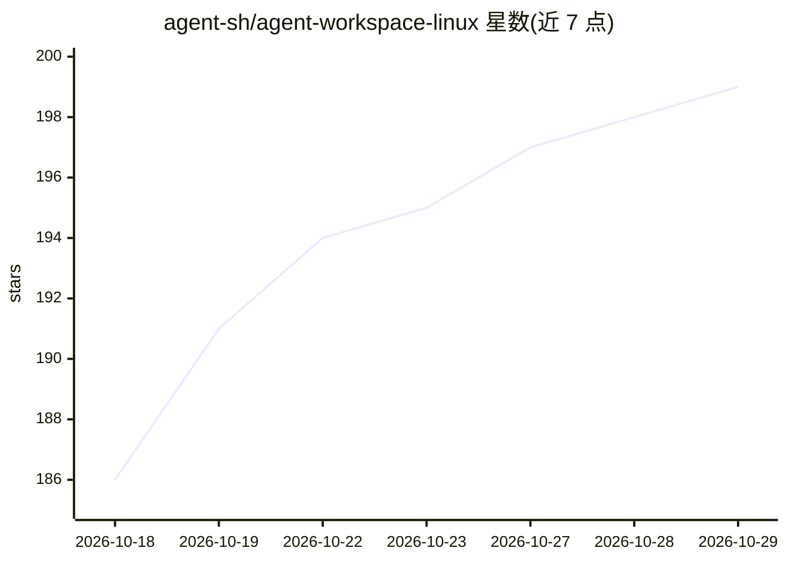

# agent-sh/agent-workspace-linux

⭐ 199 · Rust · MIT · 推送 2026-10-28 · [GitHub](https://github.com/agent-sh/agent-workspace-linux) · 个人维护

**给 AI agent 的隔离 Linux 桌面与浏览器 MCP 工作区**

通过 MCP（stdio）为 AI agent 提供一个隐藏、隔离的 X11 桌面：含 Xvfb 显示、窗口管理器、应用、剪贴板与工作区自有 Chrome 浏览器，agent 在其中启动应用、点击输入、截图和浏览网页，不占用用户真实桌面。提供可选的守护进程级权限上限（网络/挂载/应用白名单，bubblewrap 实施）、原生浮动查看器（暂停/只读/停止）、可保存的 Profile 与渐进式工具加载技能（约 86 个工具）。面向 Linux 上的 Claude Code、Codex 等 MCP host 用户；限制包括仅支持 X11、Pre-1.0 接口可能变化、单用户信任模型、无 bubblewrap 时挂载/网络策略不强制执行。

## 筛选速览

| 维度 | 判定 | 备注 |
|---|---|---|
| AI 角色 | `ai-ecosystem` | LLM/agent 周边工具 |
| 许可风险 | `permissive` | MIT |
| 部署形态 | `library` | 以包/库形式分发 |
| 模型依赖 | — | README 未给出锁定关系 |
| 硬件要求 | — | 无带数字的原话,不猜 |
| 安装摩擦 | `low` | 无编译、无系统依赖或容器化 |
| 成熟度 | `idea` | |

## 能力要点

- 隐藏 Xvfb 工作区内的窗口管理、截图、键鼠输入与剪贴板控制
- 工作区自有 Chrome 经环回 CDP 控制，不接入宿主浏览器
- 可选守护进程强制权限上限（网络/挂载/应用白名单），bubblewrap 隔离
- 附带 SKILL.md 技能按需加载约 86 个 MCP 工具

## 适用场景

- agent 做 GUI 应用或网站 QA 而不抢占我的桌面
- 在一次性隔离浏览器 Profile 中跑网页/购物自动化
- 为无人值守的长时 agent 提供可暂停、可观察的独立桌面

## 场景标签

`GUI 自动化` `浏览器自动化` · 领域:效率与自动化

## 证据(README 行号)

> L16: Agents that "use a computer" normally take over *your* screen — they move your mouse, steal focus, and drive your l
> L153: The MCP exposes ~86 tools. To avoid dumping them all into the agent's context, it ships a skill at `skills/agent-w

## 星数曲线

2026-10-18 186 → 2026-10-29 199（+13）

---
*卡片 v1 · prompt 1.4 · 生成 2026-10-22 · 置信度 high · 依据 README sha `98f1dc34c500` · [字段定义](../../DATASET.md)*
