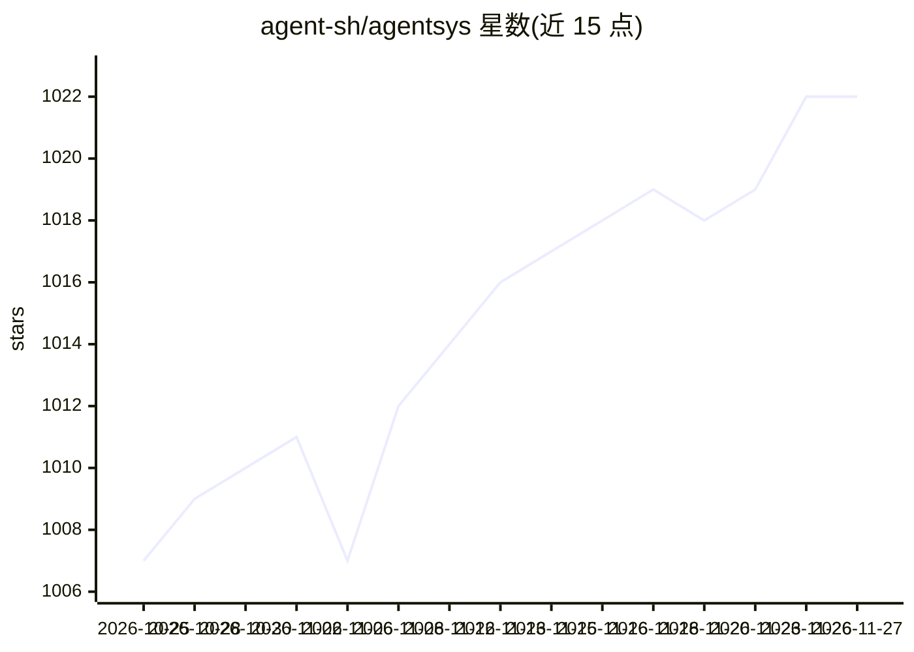

# agent-sh/agentsys

⭐ 1,022 · JavaScript · MIT · 推送 2026-11-09 · [GitHub](https://github.com/agent-sh/agentsys) · [官网](https://agent-sh.github.io/agentsys/) · 组织维护

**面向开发者的 AI agent 编排运行时：插件化自动化编码周边工作流**

一个 AI agent 编排系统，由 11 个插件、5 个 agent、14 个 skill 组成，插件以独立仓库形式发布，本仓库作为 marketplace 与安装器统一分发。系统运行在 Claude Code、OpenCode、Codex CLI、Cursor、Kiro 五个平台上，提供 issue 队列处理（/foreman）、负面记忆持久化（/banthis）、agent 配置 lint（/agnix）、skill 创建等命令，pipeline 通过阶段门控约束 agent 步骤，状态跨会话持久。设计上检测类工作用 regex/AST 等确定性手段完成，LLM 调用保留给综合、规划与评审，输出按 HIGH/MEDIUM/LOW 确定性分级。

## 筛选速览

| 维度 | 判定 | 备注 |
|---|---|---|
| AI 角色 | `ai-ecosystem` | LLM/agent 周边工具 |
| 许可风险 | `permissive` | MIT |
| 部署形态 | `library` | 以包/库形式分发 |
| 模型依赖 | — | README 未给出锁定关系 |
| 硬件要求 | — | 无带数字的原话,不猜 |
| 安装摩擦 | `low` | 无编译、无系统依赖或容器化 |
| 成熟度 | — | 结构信号不足 |

## 能力要点

- 11 插件/5 agent/14 skill 的插件化编排，marketplace 与 npm 安装器分发
- pipeline 阶段门控与跨会话持久状态
- 检测用 regex/AST 静态分析、LLM 仅用于判断环节，发现按三级确定性分级
- agnix 提供 757 条规则的 agent 配置校验，输出 SARIF 供 CI 集成

## 适用场景

- 让 agent 自动处理 GitHub issue 队列，从认领到合并落地
- 为团队持久化'禁止此类行为'的 agent 修正规则
- 在 CI 中 lint SKILL.md/CLAUDE.md 等 agent 配置文件
- 跨 Claude Code/Codex/Cursor 等多平台统一安装技能插件

## 场景标签

`编码 Agent` `代码审查` · 领域:编码与开发

## 证据(README 行号)

> L5:  A modular runtime and orchestration system for AI agents.
> L32: AI models can write code. That's not the hard part anymore. The hard part is everything around it - branch manageme
> L49: The system runs on Claude Code, OpenCode, Codex CLI, Cursor, and Kiro. Install via the marketplace or the npm insta

## 星数曲线

2026-10-25 1,007 → 2026-11-27 1,022（+15）

---
*卡片 v1 · prompt 1.4 · 生成 2026-11-24 · 置信度 high · 依据 README sha `0c91cefca4c8` · [字段定义](../../DATASET.md)*
