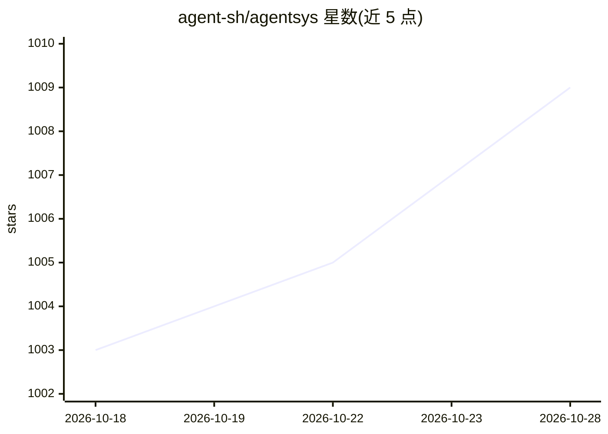

# agent-sh/agentsys

⭐ 1,009 · JavaScript · MIT · 推送 2026-10-26 · [GitHub](https://github.com/agent-sh/agentsys) · [官网](https://agent-sh.github.io/agentsys/) · 组织维护

**面向 Claude Code/Codex/Cursor 等的 agent 编排运行时与插件市场**

AgentSys 是一个模块化的 AI agent 编排运行时：将 25 个插件（各自独立仓库）、55 个 agent、47 个 skill 组合为结构化流水线，覆盖任务发现、分支管理、多 agent 代码评审、CI 监控、PR 创建与合并等软件开发环节。流水线设有阶段门禁，状态可跨会话持久化。支持在 Claude Code、OpenCode、Codex CLI、Cursor、Kiro 五个平台上运行，通过 marketplace 或 npm 安装器安装，插件从各自仓库自动拉取。另附基准数据（Sonnet+agentsys 对比 raw Opus 的成本与输出对比）。

## 筛选速览

| 维度 | 判定 | 备注 |
|---|---|---|
| AI 角色 | `ai-ecosystem` | LLM/agent 周边工具 |
| 许可风险 | `permissive` | MIT |
| 部署形态 | `library` | 以包/库形式分发 |
| 模型依赖 | — | README 未给出锁定关系 |
| 硬件要求 | — | 无带数字的原话,不猜 |
| 安装摩擦 | `low` | 无编译、无系统依赖或容器化 |
| 成熟度 | — | 结构信号不足 |

## 能力要点

- 25 插件/55 agent/47 skill 组合成阶段门禁式流水线
- 状态跨会话持久化，agent 各有单一职责与指定模型
- 支持 Claude Code、OpenCode、Codex CLI、Cursor、Kiro 五个平台
- 通过 marketplace 或 npm 安装器安装，插件自动拉取

## 适用场景

- 把 issue 到 PR 合并的任务流程交给 agent 流水线自动执行
- 在多 agent 评审循环中做代码质量、安全与测试覆盖检查
- 为 AI 编码工具补充结构化提示词与项目上下文

## 场景标签

`多智能体` `编码 Agent` `代码审查` `提示工程` · 领域:Agent 开发

## 证据(README 行号)

> L5:  A modular runtime and orchestration system for AI agents.
> L28: AI models can write code. That's not the hard part anymore. The hard part is everything around it - task selection,
> L45: The system runs on Claude Code, OpenCode, Codex CLI, Cursor, and Kiro. Install via the marketplace or the npm insta

## 星数曲线

2026-10-18 1,003 → 2026-10-28 1,009（+6）

---
*卡片 v1 · prompt 1.4 · 生成 2026-10-21 · 置信度 high · 依据 README sha `931759162b1a` · [字段定义](../../DATASET.md)*
