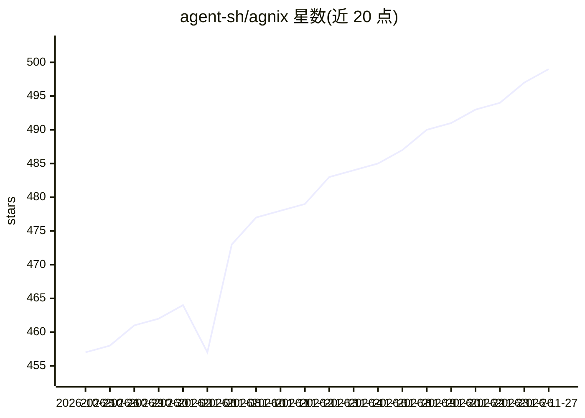

# agent-sh/agnix

⭐ 499 · Rust · Apache-2.0 · 推送 2026-11-26 · [GitHub](https://github.com/agent-sh/agnix) · 组织维护

**为 AI 编码助手配置文件提供校验与修复的 linter/LSP**

agnix 是针对 AI 编码助手配置的静态校验工具：对 CLAUDE.md、AGENTS.md、SKILL.md、hooks、MCP 等配置文件执行 763 条规则校验，并支持自动修复。支持 Claude Code、Codex CLI、Cursor、Copilot 等多工具的不同配置格式，提供 npm 安装、预编译二进制，以及 VS Code/JetBrains/Neovim/Zed 编辑器扩展与 GitHub Action。以 Rust 实现，含 CLI、LSP、MCP server 与 WASM 绑定。

## 筛选速览

| 维度 | 判定 | 备注 |
|---|---|---|
| AI 角色 | `ai-ecosystem` | LLM/agent 周边工具 |
| 许可风险 | `permissive` | Apache-2.0 |
| 部署形态 | `library` | 以包/库形式分发 |
| 模型依赖 | — | README 未给出锁定关系 |
| 硬件要求 | — | 无带数字的原话,不猜 |
| 安装摩擦 | `low` | 无编译、无系统依赖或容器化 |
| 成熟度 | — | 结构信号不足 |

## 能力要点

- 763 条规则校验 CLAUDE.md、AGENTS.md、SKILL.md、hooks、MCP 等配置文件
- 支持 14 种工具的配置格式校验，含分级维护优先级
- 提供 CLI 自动修复、LSP、MCP server 与 WASM 浏览器集成
- VS Code、JetBrains、Neovim、Zed 编辑器扩展与 GitHub Action

## 适用场景

- 在提交前校验 AI 助手配置文件，避免工具静默忽略配置
- 在多工具（Cursor + Claude Code + Copilot）混用时统一校验各格式
- 通过 GitHub Action 在 CI 中校验仓库内 agent 配置
- 为编辑器接入 LSP 实时诊断 agent 配置

## 场景标签

 · 领域:开发者工具/代码质量

## 证据(README 行号)

> L18:  Catch broken agent configs before your AI tools silently ignore them. 763 rules across Claude Code, Codex CLI, Ope
> L140: - `agnix-lsp` - language server binary

## 星数曲线

2026-10-25 457 → 2026-11-27 499（+42）

---
*卡片 v1 · prompt 1.4 · 生成 2026-11-25 · 置信度 high · 依据 README sha `03ebade27720` · [字段定义](../../DATASET.md)*
