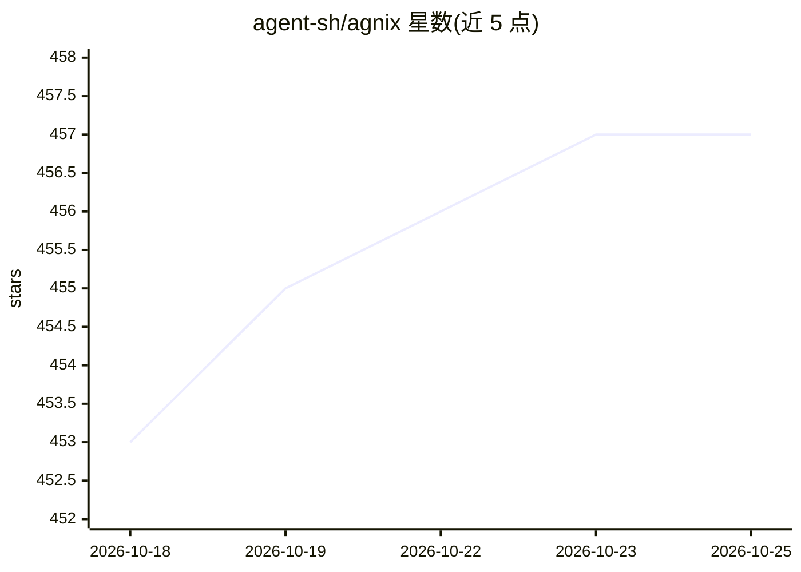

# agent-sh/agnix

⭐ 457 · Rust · Apache-2.0 · 推送 2026-10-24 · [GitHub](https://github.com/agent-sh/agnix) · 个人维护

**AI 编程助手配置文件的 linter 与 LSP，校验并自动修复**

面向使用 AI 编程助手的开发者的配置校验工具：以 702 条规则校验 CLAUDE.md、AGENTS.md、SKILL.md、hooks、MCP 配置等 agent 文件，覆盖 Claude Code、Codex CLI、Cursor、GitHub Copilot、Kiro 等 12 类工具的配置格式，支持 --fix 安全自动修复。以 Rust workspace 实现，提供 CLI、LSP、MCP server 与 WASM 绑定，附 VS Code/JetBrains/Neovim/Zed 编辑器插件与 GitHub Action。npx 或 npm 全局安装即可运行。

## 筛选速览

| 维度 | 判定 | 备注 |
|---|---|---|
| AI 角色 | `ai-ecosystem` | LLM/agent 周边工具 |
| 许可风险 | `permissive` | Apache-2.0 |
| 部署形态 | `library` | 以包/库形式分发 |
| 模型依赖 | — | README 未给出锁定关系 |
| 硬件要求 | — | 无带数字的原话,不猜 |
| 安装摩擦 | `low` | 无编译、无系统依赖或容器化 |
| 成熟度 | — | 结构信号不足 |

## 能力要点

- 702 条规则校验 12 类 AI 编程工具的配置文件（CLAUDE.md/SKILL.md/hooks/MCP 等）
- 提供 --fix 与 --fix-safe 自动修复模式
- 提供 CLI、LSP、MCP server、WASM 绑定四种形态
- VS Code/JetBrains/Neovim/Zed 编辑器插件与 GitHub Action

## 适用场景

- 在提交前发现 AI 助手配置文件的语法错误，避免技能静默失效
- 多工具混用（Cursor + Claude Code + Copilot）时校验配置兼容性
- CI 中用 GitHub Action 持续校验 agent 配置

## 场景标签

 · 领域:开发工具/Agent 配置校验

## 证据(README 行号)

> L14:  Catch broken agent configs before your AI tools silently ignore them. 702 rules across Claude Code, Codex CLI, Ope
> L36: agnix validates all of it - 702 rules sourced from official specs, academic research, and real-world breakage patte
> L97: |Tool|Rules|Count|Config Files|

## 星数曲线

2026-10-18 453 → 2026-10-25 457（+4）

---
*卡片 v1 · prompt 1.4 · 生成 2026-10-21 · 置信度 high · 依据 README sha `2bf1984ec234` · [字段定义](../../DATASET.md)*
