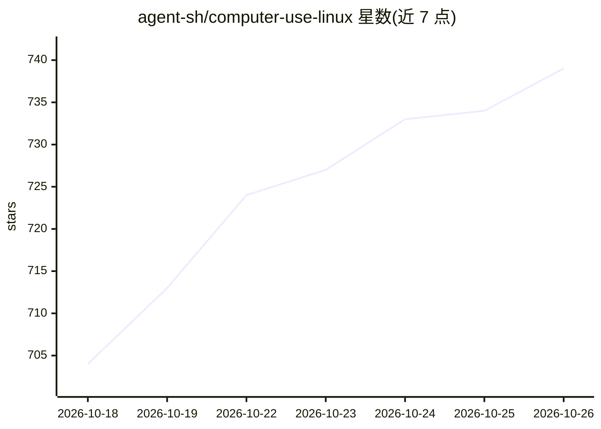

# agent-sh/computer-use-linux

⭐ 739 · Rust · MIT · 推送 2026-10-24 · [GitHub](https://github.com/agent-sh/computer-use-linux) · 组织维护

**给 AI agent 的 Linux 桌面控制 MCP 服务器与 CLI**

Rust 编写的 MCP server + CLI，让 AI agent 通过 AT-SPI 语义无障碍树、截图、组合器感知的窗口定位与 Wayland/X11 输入合成，对 GNOME、KDE、Hyprland、niri、COSMIC、i3 及 X11 桌面执行点击、拖拽、输入、语义操作等控制。所有变更类工具可在同一次调用返回后置截图与更新后的树；doctor 输出 JSON 就绪报告。从 codex-desktop-linux 抽出为独立上游。经 npm、cargo、源码脚本安装。

## 筛选速览

| 维度 | 判定 | 备注 |
|---|---|---|
| AI 角色 | `ai-ecosystem` | LLM/agent 周边工具 |
| 许可风险 | `permissive` | MIT |
| 部署形态 | `library` | 以包/库形式分发 |
| 模型依赖 | — | README 未给出锁定关系 |
| 硬件要求 | — | 无带数字的原话,不猜 |
| 安装摩擦 | `medium` | 含编译或系统依赖之一 |
| 成熟度 | — | 结构信号不足 |

## 能力要点

- AT-SPI 语义选择器（role/name/text/states）优先，像素坐标兜底
- 单次往返返回后置截图与更新的无障碍树
- 多组合器窗口定位后端（GNOME Shell/KWin/Hyprland/niri/i3/X11）
- computer-use-linux doctor 输出结构化就绪报告

## 适用场景

- 让 Claude Code / Codex 等 agent 直接操作本地 Linux 桌面
- 按窗口或终端进程精确定位输入目标（如跑 pytest 的终端）
- 通过 stdio MCP 客户端接入自动化桌面流程

## 场景标签

`GUI 自动化` · 领域:效率与自动化

## 证据(README 行号)

> L11: `computer-use-linux` gives AI agents real, structured control of a local Linux desktop: semantic AT-SPI accessibili
> L43: `computer-use-linux` is a Rust MCP server and CLI for Linux desktop control. It ships three binaries — the main `co

## 星数曲线

2026-10-18 704 → 2026-10-26 739（+35）

---
*卡片 v1 · prompt 1.4 · 生成 2026-10-21 · 置信度 high · 依据 README sha `5ab88aff56f8` · [字段定义](../../DATASET.md)*
