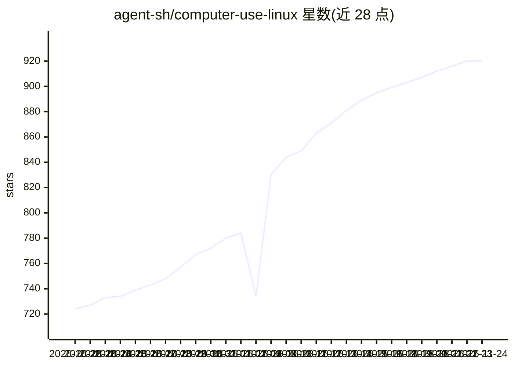

# agent-sh/computer-use-linux

⭐ 928 · Rust · MIT · 推送 2026-11-22 · [GitHub](https://github.com/agent-sh/computer-use-linux) · 组织维护

**让 AI agent 通过 MCP/CLI 控制本地 Linux 桌面的工具**

Rust 编写的 MCP 服务器与 CLI，发布于 crates.io 与 npm，为 AI agent 提供结构化的 Linux 桌面控制能力：语义 AT-SPI 无障碍树、截图、按合成器感知的窗口定位，以及 Wayland/X11 输入合成，支持 GNOME、KDE、Hyprland、niri、COSMIC、i3、Sway、labwc 等。提供 doctor 就绪检查与 setup 命令，预编译 x86_64/aarch64 二进制要求 glibc ≥2.28，旧系统需从源码构建。

## 筛选速览

| 维度 | 判定 | 备注 |
|---|---|---|
| AI 角色 | `ai-ecosystem` | LLM/agent 周边工具 |
| 许可风险 | `permissive` | MIT |
| 部署形态 | `library` | 以包/库形式分发 |
| 模型依赖 | — | README 未给出锁定关系 |
| 硬件要求 | — | 无带数字的原话,不猜 |
| 安装摩擦 | `medium` | 含编译或系统依赖之一 |
| 成熟度 | — | 结构信号不足 |

## 能力要点

- 以 MCP 服务器与 CLI 形式提供桌面观察与输入能力（截图、点击、拖动、滚动、键入、语义动作）
- 窗口定位按合成器选择后端（GNOME 扩展、KWin DBus、hyprctl、niri IPC、i3 IPC、wlr-foreign-toplevel 等）
- snapshot_id 机制防止点击落到过期树中的元素
- doctor 输出结构化 JSON 就绪报告，含阻塞项与建议步骤

## 适用场景

- 让 Claude Code/Codex 等agent 在 Linux 桌面上执行点击、输入与窗口操作
- 在无头或自动化流程中通过语义选择器驱动 GUI 应用
- 为隔离桌面环境搭建 agent 工作区（配合 agent-workspace-linux）

## 场景标签

`GUI 自动化` · 领域:效率与自动化

## 证据(README 行号)

> L2:  Native Linux desktop control for AI agents over MCP, Pi native tools, and CLI.
> L47: `computer-use-linux` is a Rust MCP server and CLI for Linux desktop control. It ships three binaries: the main `com

## 星数曲线

2026-10-22 724 → 2026-11-24 920（+196）

---
*卡片 v1 · prompt 1.4 · 生成 2026-11-24 · 置信度 high · 依据 README sha `75d3f9aa8eff` · [字段定义](../../DATASET.md)*
