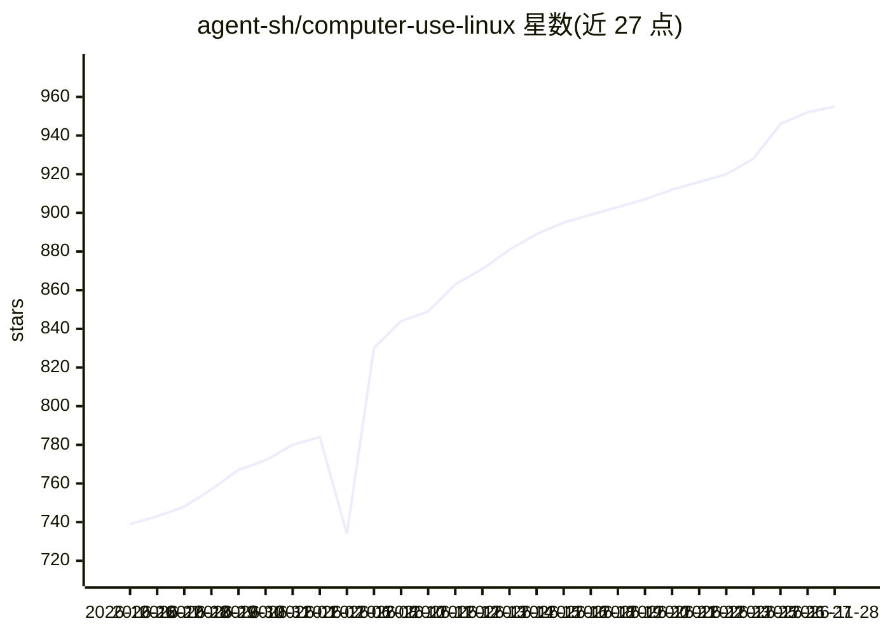

# agent-sh/computer-use-linux

⭐ 955 · Rust · MIT · 推送 2026-11-27 · [GitHub](https://github.com/agent-sh/computer-use-linux) · 组织维护

**给 Linux 上 AI agent 提供桌面控制能力的 MCP 服务器与 CLI**

Rust 编写的 MCP 服务器与 CLI，向 AI agent 暴露本地 Linux 桌面控制能力：语义 AT-SPI 无障碍树读取、有界截图、按合成器适配的窗口定位与激活（GNOME/KDE/Hyprland/Sway 等及 X11）、Wayland/X11 输入合成，以及操作后单次回传验证截图与树。提供 doctor 就绪度 JSON 报告、批量工具调用与可选 shell/REPL 工具。预编译 x86_64/aarch64 二进制要求 glibc 2.28+，旧系统需从源码构建。

## 筛选速览

| 维度 | 判定 | 备注 |
|---|---|---|
| AI 角色 | `ai-ecosystem` | LLM/agent 周边工具 |
| 许可风险 | `permissive` | MIT |
| 部署形态 | `library` | 以包/库形式分发 |
| 模型依赖 | locked-api |  |
| 硬件要求 | — | 无带数字的原话,不猜 |
| 安装摩擦 | `medium` | 含编译或系统依赖之一 |
| 成熟度 | — | 结构信号不足 |

## 能力要点

- 通过 MCP/CLI 提供语义选择器点击、按键、输入与 AT-SPI 动作调用
- 窗口定位按合成器逐一尝试后端并报告命中原因
- doctor 命令输出结构化就绪度 JSON 报告
- GNOME/Wayland 提供人类可见但截图不可见的操作指示浮层

## 适用场景

- 让 MCP 客户端（Claude Code/Codex 等）操作 Linux 桌面完成 GUI 任务
- 在无头或真实桌面上为 agent 提供窗口与输入控制
- 用语义选择器替代像素坐标做自动化点击与文本输入

## 场景标签

`GUI 自动化` `编码 Agent` · 领域:效率与自动化

## 证据(README 行号)

> L2:  Native Linux desktop control for AI agents over MCP, Pi native tools, and CLI.
> L15: `computer-use-linux` gives AI agents real, structured control of a local Linux desktop: semantic AT-SPI accessibili
> L47: `computer-use-linux` is a Rust MCP server and CLI for Linux desktop control. It ships three binaries: the main `com

## 星数曲线

2026-10-26 739 → 2026-11-28 955（+216）

---
*卡片 v1 · prompt 1.4 · 生成 2026-11-28 · 置信度 high · 依据 README sha `b8fbf4764c2e` · [字段定义](../../DATASET.md)*
