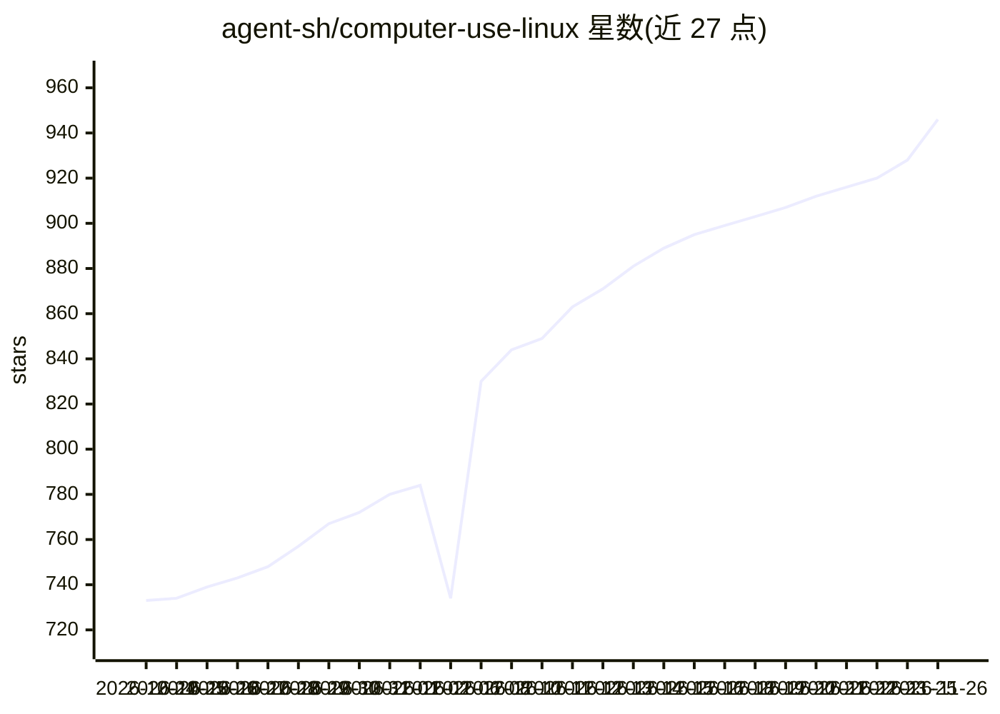

# agent-sh/computer-use-linux

⭐ 946 · Rust · MIT · 推送 2026-11-25 · [GitHub](https://github.com/agent-sh/computer-use-linux) · 组织维护

**为 Linux 上的 AI agent 提供桌面控制的 MCP 服务器与 CLI**

Rust 实现的 MCP 服务器与 CLI，让 agent 读取与操作本地 Linux 桌面：提供 AT-SPI 语义无障碍树、限定尺寸截图、按合成器适配的窗口定位（GNOME/KWin/Hyprland/niri/i3/Sway 等）以及 Wayland/X11 输入合成，点击等修改型工具可在同一次往返中返回动作后的截图与树。以 crates.io 与 npm 包发布，提供预编译 x86_64/aarch64 二进制（需 glibc≥2.28），旧系统需从源码构建；另有独立指示器 overlay 与 COSMIC 辅助进程两个二进制。

## 筛选速览

| 维度 | 判定 | 备注 |
|---|---|---|
| AI 角色 | `ai-ecosystem` | LLM/agent 周边工具 |
| 许可风险 | `permissive` | MIT |
| 部署形态 | `library` | 以包/库形式分发 |
| 模型依赖 | locked-api |  |
| 硬件要求 | — | 无带数字的原话,不猜 |
| 安装摩擦 | `medium` | 含编译或系统依赖之一 |
| 成熟度 | — | 结构信号不足 |

## 能力要点

- AT-SPI 语义选择器优先的点击/动作/取值，带动作后截图验证
- 按合成器依序尝试多后端的窗口注册表并报告命中后端
- doctor 命令输出结构化 JSON 就绪报告
- 支持 GNOME/KDE/Hyprland/niri/COSMIC/i3/Sway/labwc 等 Wayland 与 X11

## 适用场景

- 让 Claude Code/Codex 等 MCP 宿主通过语义元素而非像素坐标操作 Linux 桌面
- 在 Wayland 会话中为 agent 提供可用的截图与窗口控制
- 隔离桌面环境下运行执行桌面操作的 agent

## 场景标签

`GUI 自动化` · 领域:效率与自动化

## 证据(README 行号)

> L2:  Native Linux desktop control for AI agents over MCP, Pi native tools, and CLI.
> L15: `computer-use-linux` gives AI agents real, structured control of a local Linux desktop: semantic AT-SPI accessibili
> L47: `computer-use-linux` is a Rust MCP server and CLI for Linux desktop control. It ships three binaries: the main `com

## 星数曲线

2026-10-24 733 → 2026-11-26 946（+213）

---
*卡片 v1 · prompt 1.4 · 生成 2026-11-26 · 置信度 high · 依据 README sha `536a582e1408` · [字段定义](../../DATASET.md)*
