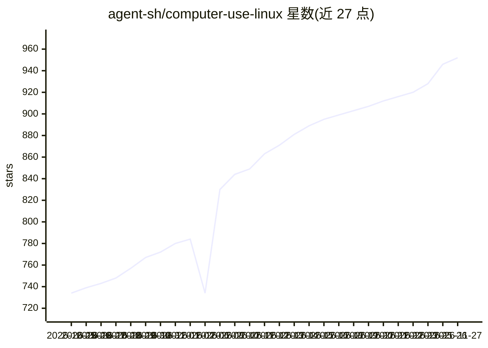

# agent-sh/computer-use-linux

⭐ 952 · Rust · MIT · 推送 2026-11-26 · [GitHub](https://github.com/agent-sh/computer-use-linux) · 组织维护

**为 Linux 桌面上的 AI agent 提供本地桌面控制（MCP/CLI）**

Rust 编写的 MCP 服务器与 CLI，为 AI agent 提供本地 Linux 桌面的结构化控制：AT-SPI 无障碍树读取、受限截图、感知合成器的窗口定位、Wayland/X11 输入合成与单次往返的操作后验证。支持 GNOME、KDE Plasma、Hyprland、niri、COSMIC、i3、Sway、labwc 等 wlroots 合成器及 X11/EWMH。提供 npm 包、crates.io crate 与源码安装，预编译 x86_64/aarch64 二进制需 glibc 2.28+。该 crate 由 Codex Desktop 的 Linux 发行版抽取而来，本仓库为其上游。

## 筛选速览

| 维度 | 判定 | 备注 |
|---|---|---|
| AI 角色 | `ai-ecosystem` | LLM/agent 周边工具 |
| 许可风险 | `permissive` | MIT |
| 部署形态 | `library` | 以包/库形式分发 |
| 模型依赖 | — | README 未给出锁定关系 |
| 硬件要求 | — | 无带数字的原话,不猜 |
| 安装摩擦 | `medium` | 含编译或系统依赖之一 |
| 成熟度 | — | 结构信号不足 |

## 能力要点

- Wayland 原生输入路径：/dev/uinput 或 freedesktop portal RemoteDesktop
- 感知合成器的窗口定位，支持多后端按序尝试并报告结果
- 语义选择器优先的点击/操作，AT-SPI element_index 定位
- doctor 命令输出结构化 JSON 就绪报告

## 适用场景

- 让 Claude Code 等 MCP 宿主通过 MCP 操作 Linux 桌面
- 自动化桌面应用测试与 UI 操作
- 在隔离工作区中运行 agent 桌面任务

## 场景标签

`GUI 自动化` · 领域:效率与自动化

## 证据(README 行号)

> L15: `computer-use-linux` gives AI agents real, structured control of a local Linux desktop: semantic AT-SPI accessibili
> L47: `computer-use-linux` is a Rust MCP server and CLI for Linux desktop control. It ships three binaries: the main `com

## 星数曲线

2026-10-25 734 → 2026-11-27 952（+218）

---
*卡片 v1 · prompt 1.4 · 生成 2026-11-27 · 置信度 high · 依据 README sha `8a8e6c45ccf3` · [字段定义](../../DATASET.md)*
