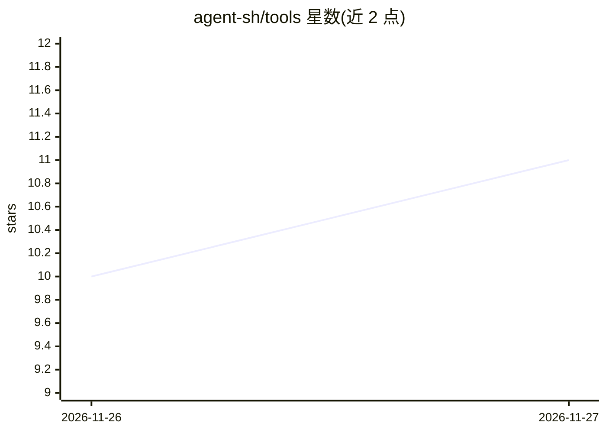

# agent-sh/tools

⭐ 11 · TypeScript · MIT · 推送 2026-11-26 · [GitHub](https://github.com/agent-sh/tools) · 个人维护

**为 LLM agent 设计的文件/搜索/网络工具集（npm+Rust 双发布）**

面向 agent 工具调用场景的基础工具库，覆盖 read、write/edit、grep、glob、bash、webfetch、websearch、lsp、skill、batch 十类操作，每个工具独立发布为 npm 包与同行为 Rust crate。针对模型调用者的特点（猜参数名、记错路径）做设计：类型化结果而非异常、错误带恢复提示、越界操作走权限检查（roots 围栏、敏感文件拦截、hook 门控）。websearch 提供无 API key 的多引擎链，web-mcp 可作为 MCP server 接入 Claude Code 与 Codex。

## 筛选速览

| 维度 | 判定 | 备注 |
|---|---|---|
| AI 角色 | `ai-ecosystem` | LLM/agent 周边工具 |
| 许可风险 | `permissive` | MIT |
| 部署形态 | `library` | 以包/库形式分发 |
| 模型依赖 | local-ok | 支持本地模型 |
| 硬件要求 | — | 无带数字的原话,不猜 |
| 安装摩擦 | `low` | 无编译、无系统依赖或容器化 |
| 成熟度 | — | 结构信号不足 |

## 能力要点

- 每个工具独立发布 npm 包与 Rust crate，行为对齐
- 类型化结果 + 错误恢复提示 + 别名纠错的模型友好契约
- websearch 无需 API key（Exa/Parallel/Mojeek/Marginalia/Wikipedia 引擎链）
- fail-closed 权限体系：roots 围栏、敏感文件模式、hook 门控

## 适用场景

- 给自己的 agent loop 提供文件读写、代码搜索与 shell 工具
- 通过 MCP 让 Claude Code/Codex 获得无需密钥的网页搜索与抓取
- 以 Rust crate 形式在 Rust 项目中复用同一套 agent 工具

## 场景标签

`Agent 框架` · 领域:Agent 开发

## 证据(README 行号)

> L3: **Agent tools built for how LLMs actually call tools:** `read`, `write`/`edit`, `grep`, `glob`, `bash`, `webfetch`, 
> L9: Most tool libraries are written for deterministic callers. The caller here is a model (Claude, GPT, Qwen, Gemini and
> L83: Every tool exports a ready-made definition (`name`, `description`, JSON Schema `inputSchema`) to hand to the model,

## 星数曲线

2026-11-26 10 → 2026-11-27 11（+1）

---
*卡片 v1 · prompt 1.4 · 生成 2026-11-26 · 置信度 high · 依据 README sha `6a3c3c8ca8cc` · [字段定义](../../DATASET.md)*
