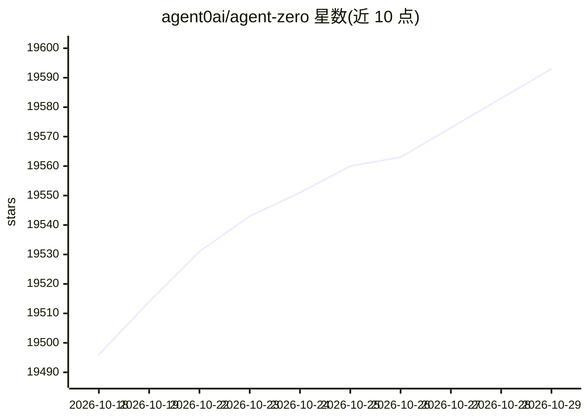

# agent0ai/agent-zero

⭐ 19,593 · Python · NOASSERTION · 推送 2026-10-28 · [GitHub](https://github.com/agent0ai/agent-zero) · [官网](https://agent-zero.ai) · 组织维护

**给 agent 一个完整 Dockerized Linux 环境的开源框架**

开源 agent 框架，核心是在 Docker 容器内提供完整 Linux 桌面（XFCE），agent 可操作真实 GUI 软件、终端与文件。功能包括内置浏览器（DOM 标注/改写元素）、与 agent 实时协作编辑 Markdown 与 LibreOffice 文档、100+ 社区插件的 Plugin Hub、项目级记忆与配置隔离、子 agent 分工协作，以及通过 A0 CLI 连接宿主机文件。依赖 Docker 运行，提供 Launcher 安装器、脚本安装器与直接 docker run 三条路径。

## 筛选速览

| 维度 | 判定 | 备注 |
|---|---|---|
| AI 角色 | `ai-native` | 本体是模型或模型工具 |
| 许可风险 | `none` | NOASSERTION |
| 部署形态 | `self-host` | docker 或自建部署 |
| 模型依赖 | — | README 未给出锁定关系 |
| 硬件要求 | — | 无带数字的原话,不猜 |
| 安装摩擦 | `low` | 无编译、无系统依赖或容器化 |
| 成熟度 | — | 结构信号不足 |

## 动量与使用信号

- 维护:`active` — 距上次 push 3.5 天,年发版 40,58 位贡献者
- 涨星:近 1 天 **+12**(自 20261016 起算)
- 下载:GitHub Release 附件 累计 6,331(76 个 release)
- 平台:WINDOWS / MACOS / LINUX / WEB · 协议:MCP

## 能力要点

- 容器内真实 XFCE Linux 桌面，agent 可驱动 GUI 软件如 Blender
- 浏览器 Annotate 模式：点击页面元素生成检查/修改/复刻指令
- Plugin Hub 提供 100+ 社区插件，支持 MCP 服务器与 A2A 连接
- 子 agent 分工协作与项目级记忆/密钥隔离

## 适用场景

- 让 agent 操作真实桌面软件完成建模、编辑等任务
- 在浏览器上标注 UI 并让 agent 实现修改
- 与 agent 实时协作编辑文档和表格
- 通过 A0 CLI 让容器内 agent 操作本地代码仓库

## 场景标签

`Agent 框架` `GUI 自动化` · 领域:Agent 开发

## 证据(README 行号)

> L6: Agent Zero is an open agent framework for work that needs more than chat: a Dockerized Linux desktop, a browser with
> L26: |**Full Linux desktop**|The agent can use real GUI software, terminals, files, and desktop apps inside the Canvas.|
> L110: Agent Zero opens its own Linux desktop inside the right-side Canvas. Not a remote VM, not a shared clipboard, but 

## 星数曲线

2026-10-18 19,496 → 2026-10-29 19,593（+97）

---
*卡片 v1 · prompt 1.4 · 生成 2026-10-18 · 置信度 high · 依据 README sha `59630c61c8f7` · [字段定义](../../DATASET.md)*
