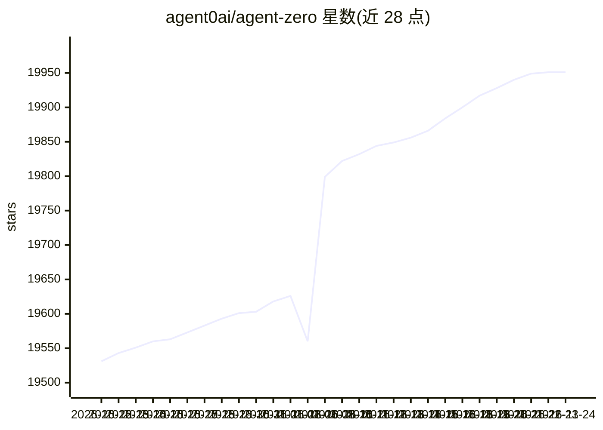

# agent0ai/agent-zero

⭐ 19,964 · Python · NOASSERTION · 推送 2026-11-23 · [GitHub](https://github.com/agent0ai/agent-zero) · [官网](https://agent-zero.ai) · 组织维护

**带完整 Linux 工作区的开源 AI 代理框架**

开源 AI 代理框架，为每个代理实例提供独立的 Linux 沙箱工作区，通过终端、浏览器和桌面应用执行研究、编码、文档处理等任务。核心机制包括：Canvas 面板内嵌浏览器与 XFCE 桌面（可人工接管）、Markdown/LibreOffice 文档协同编辑、Plugin Hub 插件体系、Projects 工作区隔离、多代理任务委派、A2A 协议接入外部代理，以及工作区快照回滚的 Time Travel。依赖 Docker 运行，需配置云端供应商、AI 账号或本地模型方可对话。

## 筛选速览

| 维度 | 判定 | 备注 |
|---|---|---|
| AI 角色 | `ai-ecosystem` | LLM/agent 周边工具 |
| 许可风险 | `none` | NOASSERTION |
| 部署形态 | `self-host` | docker 或自建部署 |
| 模型依赖 | — | README 未给出锁定关系 |
| 硬件要求 | — | 无带数字的原话,不猜 |
| 安装摩擦 | `low` | 无编译、无系统依赖或容器化 |
| 成熟度 | — | 结构信号不足 |

## 动量与使用信号

- 维护:`active` — 距上次 push 3.5 天,年发版 40,58 位贡献者
- 涨星:近 1 天 **+12**(自 20261016 起算)
- 下载:GitHub Release 附件 累计 6,331(76 个 release)
- 平台:WINDOWS / MACOS / LINUX / WEB · 协议:MCP

## 能力要点

- 每个实例自带 Linux 沙箱工作区，可用终端、浏览器与桌面应用（如 Blender）
- Plugin Hub 支持社区插件，可通过 MCP 与 A2A 扩展工具和代理
- Projects 隔离工作区、指令、记忆与密钥，支持克隆 Git 仓库作为项目上下文
- Time Travel 工作区快照，支持对比与回滚

## 适用场景

- 让代理检查代码库、做局部修改并运行测试
- 浏览网页并标注元素，迭代自己的 UI 设计
- 在浏览器里协同编辑电子表格与文档并导出 ODT/ODS/ODP
- 从 Pi、Hermes Agent 或 Claude Code 迁移既有对话继续使用

## 场景标签

`编码 Agent` `AI 助手` · 领域:编码与开发

## 证据(README 行号)

> L119: |Add providers, tools, and integrations|Plugin Hub|
> L211: Almost nothing is hidden. Prompts live in `prompts/`, tools live in `tools/` or plugins, and built-in behavior can
> L213: You can add tools through plugins or MCP, connect other agents through A2A, and give each project its own instruct

## 星数曲线

2026-10-22 19,531 → 2026-11-24 19,951（+420）

---
*卡片 v1 · prompt 1.4 · 生成 2026-11-23 · 置信度 mid · 依据 README sha `54c3f502eea8` · [字段定义](../../DATASET.md)*
