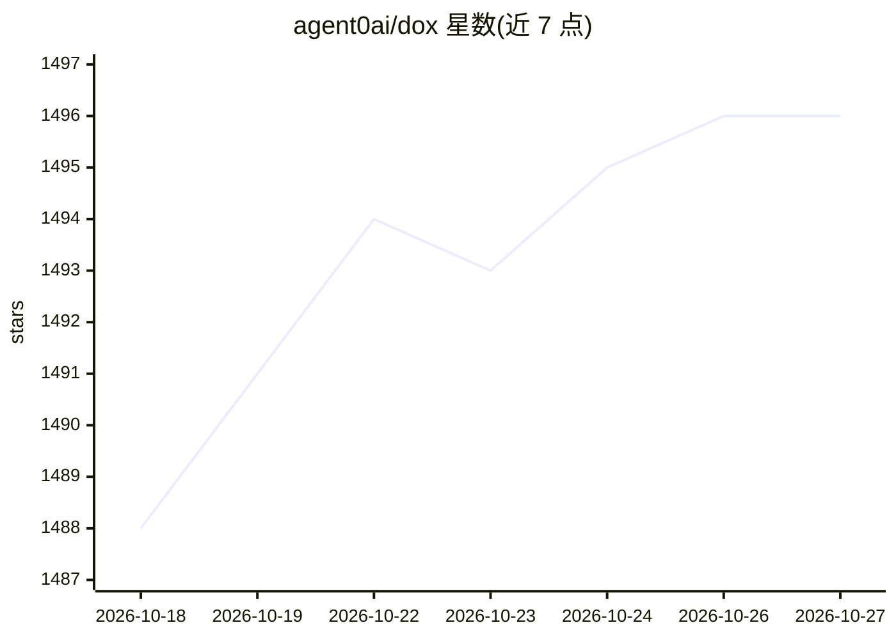

# agent0ai/dox

⭐ 1,496 · MIT · 推送 2026-09-01 · [GitHub](https://github.com/agent0ai/dox) · [官网](https://agent-zero.ai) · 组织维护

**让 AI agent 自维护 AGENTS.md 文档树的指令框架**

DOX 是一个以单一 Markdown 指令文件形式提供的 AGENTS.md 框架：agent 在项目中维护从根 AGENTS.md（全局指令与索引）到子目录 AGENTS.md（局部规则）的层级文档树；编辑前自根向下遍历相关文档以获取局部规范，编辑后更新受影响的 AGENTS.md，使项目文档随变更保持同步。使用方式为将文件内容复制进项目，无安装、无依赖、无运行时，兼容任何支持 AGENTS.md 的 AI agent 工具。

## 筛选速览

| 维度 | 判定 | 备注 |
|---|---|---|
| AI 角色 | `ai-ecosystem` | LLM/agent 周边工具 |
| 许可风险 | `permissive` | MIT |
| 部署形态 | `None` |  |
| 模型依赖 | — | README 未给出锁定关系 |
| 硬件要求 | — | 无带数字的原话,不猜 |
| 安装摩擦 | `low` | 无编译、无系统依赖或容器化 |
| 成熟度 | — | 结构信号不足 |

## 能力要点

- 单文件 Markdown 指令，无安装/依赖/运行时
- 维护根到子目录的层级 AGENTS.md 文档树
- 编辑前遍历文档树获取局部规则，编辑后同步更新文档
- 支持通过一句指令初始化现有项目的 DOX 树

## 适用场景

- 让 AI 编码 agent 在编辑前读取项目局部规则，减少盲目修改
- 让大型项目的上下文文档随代码变更自动保持最新
- 为尚无 AGENTS.md 的项目快速建立 agent 上下文规范

## 场景标签

`提示工程` `知识库管理` · 领域:Agent 开发

## 证据(README 行号)

> L5: DOX is a tiny AGENTS.md framework that gives an AI agent precise project context.
> L25: That's it. No installation, no dependencies, no package, no runtime. DOX is just a Markdown instruction for AI agen

## 星数曲线

2026-10-18 1,488 → 2026-10-27 1,496（+8）

---
*卡片 v1 · prompt 1.4 · 生成 2026-10-21 · 置信度 high · 依据 README sha `ef60a46e3204` · [字段定义](../../DATASET.md)*
