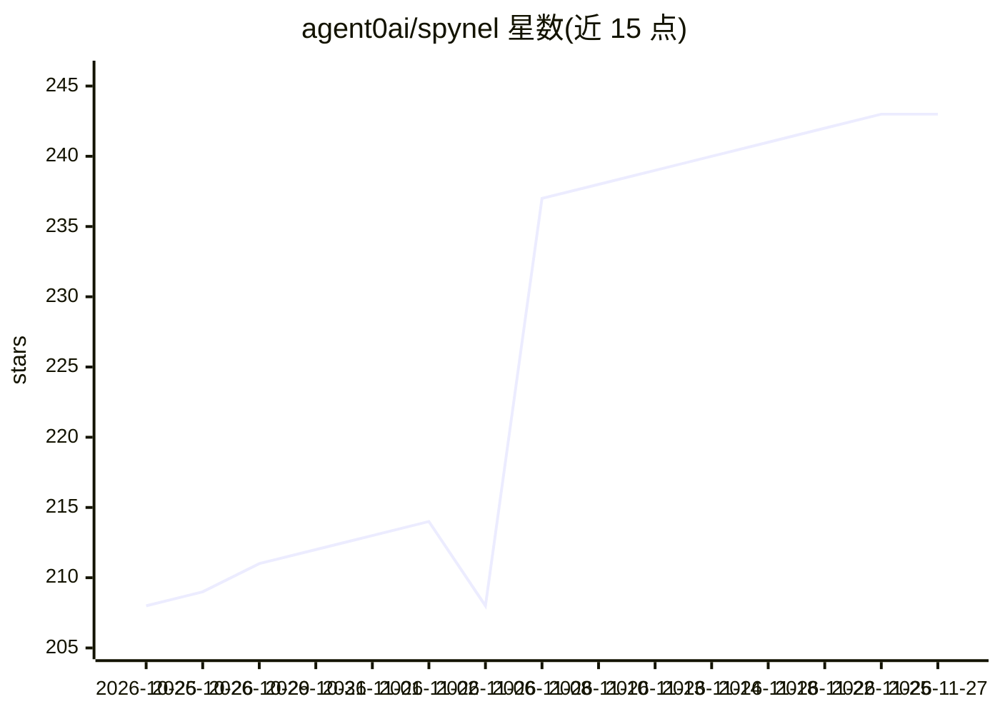

# agent0ai/spynel

⭐ 243 · Go · MIT · 推送 2026-11-18 · [GitHub](https://github.com/agent0ai/spynel) · [官网](https://agent-zero.ai) · 组织维护

**单人单聊统一入口的 AI agent 编排工具**

Spynel 是 Agent Zero 团队推出的编排程序，自身不含 AI，调用用户已有的 Codex、Claude Code 等编码 harness 执行工作。提供三大机制：终端聊天 UI/Telegram/WhatsApp 的单一通信接口、Markdown 格式的任务与目标持久化管理、以及包含计划/实现/审查/恢复的 agentic 循环。支持 macOS 与 Linux，通过安装脚本或 npm 安装，附带 update/killall/config 等 CLI 命令与卸载脚本。

## 筛选速览

| 维度 | 判定 | 备注 |
|---|---|---|
| AI 角色 | `ai-ecosystem` | LLM/agent 周边工具 |
| 许可风险 | `permissive` | MIT |
| 部署形态 | `library` | 以包/库形式分发 |
| 模型依赖 | — | README 未给出锁定关系 |
| 硬件要求 | — | 无带数字的原话,不猜 |
| 安装摩擦 | `low` | 无编译、无系统依赖或容器化 |
| 成熟度 | — | 结构信号不足 |

## 能力要点

- 单聊天界面统一管理多个独立 agent 的编排框架
- 支持终端 TUI、Telegram、WhatsApp 与语音通信
- Markdown 任务管理：目标、决策、证据与状态持久化
- agentic 循环：计划、实现、审查、恢复并请求人工判断

## 适用场景

- 通过一个助手统一接管多个编码 agent 的项目协调
- 用 Telegram/WhatsApp 远程指挥 AI 自动化任务
- 需要任务状态可审计、可恢复的长期 agent 工作流

## 场景标签

`工作流自动化` `Agent 框架` · 领域:Agent 开发

## 证据(README 行号)

> L33: - Spynel is a lightweight program with no AI inside.
> L34: - Spynel uses your existing Codex, Claude Code and other coding harnesses to do the work for it.
> L35: - Spynel provides communication interface for you and orchestration framework for agents.

## 星数曲线

2026-10-25 208 → 2026-11-27 243（+35）

---
*卡片 v1 · prompt 1.4 · 生成 2026-11-25 · 置信度 high · 依据 README sha `7e63239ae56b` · [字段定义](../../DATASET.md)*
