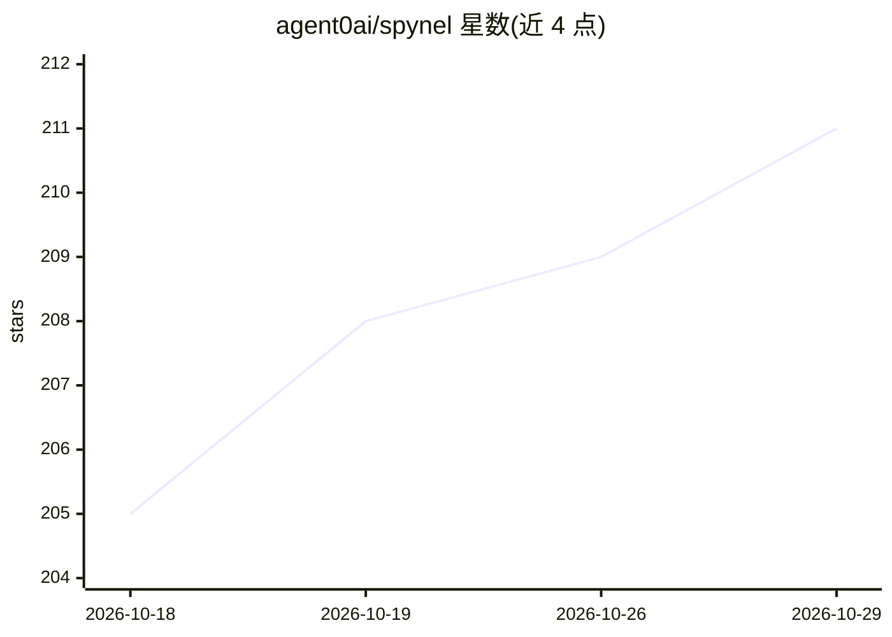

# agent0ai/spynel

⭐ 211 · Go · MIT · 推送 2026-10-25 · [GitHub](https://github.com/agent0ai/spynel) · [官网](https://agent-zero.ai) · 组织维护

**单聊天界面的 agent 编排工具：统一协调已有编码 agent**

一个轻量级 CLI 程序，自身不含模型，通过用户已有的 Codex、Claude Code 等编码 harness 执行工作。提供三个支柱：单一通信界面（终端 TUI、Telegram、WhatsApp）、Markdown 持久化任务管理（任务/目标/决策/证据可被任意 AI harness 检查）、以及规划-实现-审查-恢复的 agentic loop，在需要时请求人工判断。适用于希望用单一助手管理多个独立 agent 的个人开发者。通过 curl 安装脚本或 npm 全局安装，需 Node.js 18+（npm 途径）。

## 筛选速览

| 维度 | 判定 | 备注 |
|---|---|---|
| AI 角色 | `ai-ecosystem` | LLM/agent 周边工具 |
| 许可风险 | `permissive` | MIT |
| 部署形态 | `library` | 以包/库形式分发 |
| 模型依赖 | — | README 未给出锁定关系 |
| 硬件要求 | — | 无带数字的原话,不猜 |
| 安装摩擦 | `low` | 无编译、无系统依赖或容器化 |
| 成熟度 | — | 结构信号不足 |

## 能力要点

- 自身无内置模型，调用用户已有的 Codex、Claude Code 等编码 harness
- 单一通信界面：终端 TUI、Telegram、WhatsApp
- Markdown 持久化任务管理，任务/目标/决策/证据可被任意 AI harness 检查
- agentic loop 覆盖规划、实现、审查、恢复并可请求人工判断

## 适用场景

- 用一个聊天入口统一指挥多个编码 agent 处理不同项目
- 通过 Telegram 或 WhatsApp 在手机上管理本地的 agent 工作
- 让任务状态与决策记录以 Markdown 形式持久化、可检查

## 场景标签

`编码 Agent` `多智能体` · 领域:Agent 开发

## 证据(README 行号)

> L33: - Spynel is a lightweight program with no AI inside.
> L34: - Spynel uses your existing Codex, Claude Code and other coding harnesses to do the work for it.
> L35: - Spynel provides communication interface for you and orchestration framework for agents.

## 星数曲线

2026-10-18 205 → 2026-10-29 211（+6）

---
*卡片 v1 · prompt 1.4 · 生成 2026-10-22 · 置信度 high · 依据 README sha `e0fcaedec16f` · [字段定义](../../DATASET.md)*
