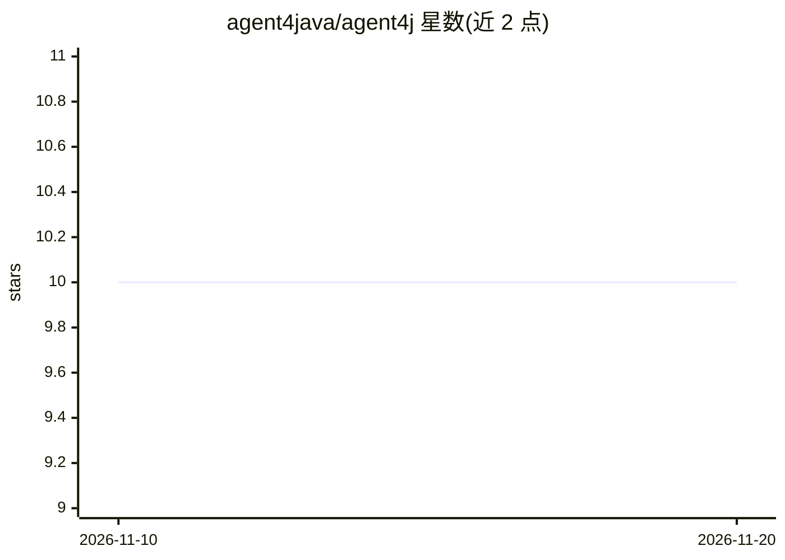

# agent4java/agent4j

⭐ 10 · Java · NOASSERTION · 推送 2026-06-08 · [GitHub](https://github.com/agent4java/agent4j) · 个人维护 · 中文 README

**基于 Spring Boot 的 Java 轻量级多智能体框架**

面向 Java/Spring Boot 开发者的多智能体框架，受 openai-agents-python 启发，将 Agent、工具调用、Agent 间 Handoff、会话记忆、Guardrail 抽象为可插拔组件。分为 core 模块与 spring-boot-starter 模块，starter 提供自动装配与配置绑定，内置对 OpenAI 格式 HTTP 接口的访问实现（Provider 枚举含 OPENAI、DEEPSEEK），无需依赖 Spring AI。构建方式为 Maven 本地安装，当前版本为 0.1.0-SNAPSHOT。

## 筛选速览

| 维度 | 判定 | 备注 |
|---|---|---|
| AI 角色 | `ai-ecosystem` | LLM/agent 周边工具 |
| 许可风险 | `none` | NOASSERTION |
| 部署形态 | `None` |  |
| 模型依赖 | locked-api |  |
| 硬件要求 | — | 无带数字的原话,不猜 |
| 安装摩擦 | `low` | 无编译、无系统依赖或容器化 |
| 成熟度 | `idea` | |

## 能力要点

- Agent/Tool/Handoff/Session/Guardrail 接口化封装，可插拔
- spring-boot-starter 自动装配 AgentRunner 与 LLM Bean
- 内置 OpenAI 与 DeepSeek 格式的 HTTP 客户端
- 支持自定义 ModelInvoker 替换默认实现

## 适用场景

- 在 Spring Boot 项目中构建多智能体应用
- 通过 FunctionToolRegistry 把 Java 函数暴露为 LLM 工具
- 配置输入/输出 Guardrail 做约束校验
- 用 InMemorySession 或自定义 Session 共享多轮上下文

## 场景标签

`多智能体` `Agent 框架` · 领域:Agent 开发

## 证据(README 行号)

> L3: agent4j 是一个基于 Spring Boot 的**轻量级多智能体（multi‑agent）框架**，设计灵感来自 openai-agents-python。
> L9: - `agent4j-spring-boot-starter`：Spring Boot 自动装配与配置封装（Starter）

## 星数曲线

2026-11-10 10 → 2026-11-20 10（+0）

---
*卡片 v1 · prompt 1.4 · 生成 2026-11-20 · 置信度 high · 依据 README sha `cfc8271e9d18` · [字段定义](../../DATASET.md)*
