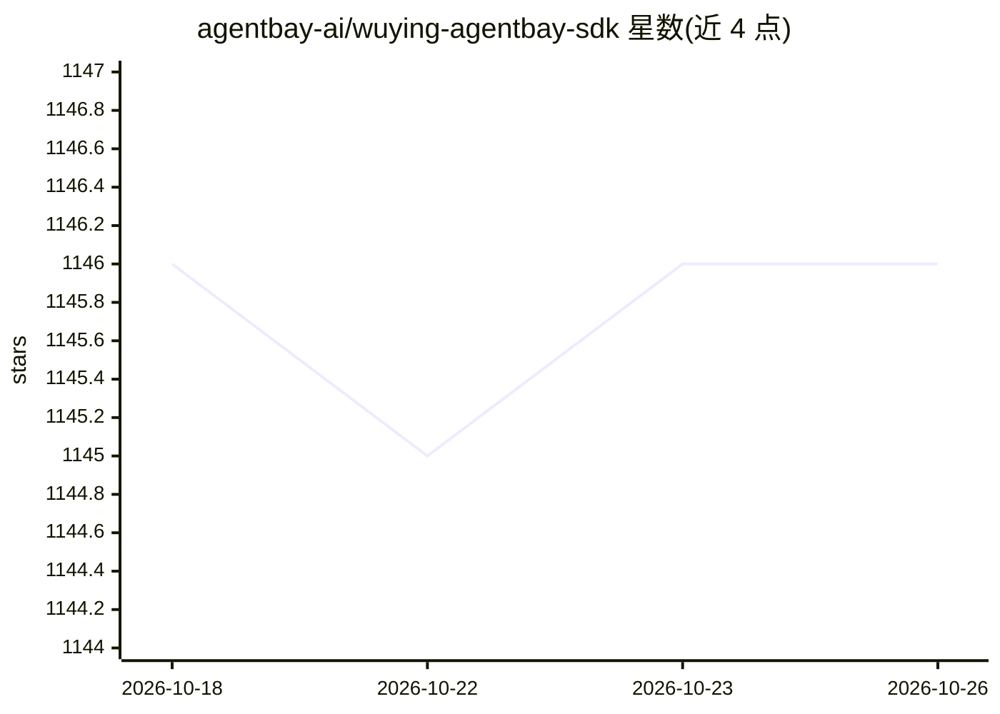

# agentbay-ai/wuying-agentbay-sdk

⭐ 1,146 · Python · Apache-2.0 · 推送 2026-06-08 · [GitHub](https://github.com/agentbay-ai/wuying-agentbay-sdk) · [官网](https://www.aliyun.com/product/agentbay) · 组织维护 · 中文 README

**面向 AI agent 的按需云沙箱 SDK：秒级创建隔离环境**

AgentBay 提供按需创建的云端沙箱，内含浏览器、桌面、移动端与代码执行环境，供 AI agent 在隔离环境中执行命令、抓取网页、自动化桌面/移动应用或运行代码，用完即销毁。提供 Python、TypeScript、Golang、Java 四种语言的 SDK，内置会话管理、命令执行、文件操作、数据持久化与 Git 操作等模块。使用前需注册阿里云账号并获取 API Key，沙箱运行于云端，无需本地基础设施。

## 筛选速览

| 维度 | 判定 | 备注 |
|---|---|---|
| AI 角色 | `ai-ecosystem` | LLM/agent 周边工具 |
| 许可风险 | `permissive` | Apache-2.0 |
| 部署形态 | `library` | 以包/库形式分发 |
| 模型依赖 | — | README 未给出锁定关系 |
| 硬件要求 | — | 无带数字的原话,不猜 |
| 安装摩擦 | `low` | 无编译、无系统依赖或容器化 |
| 成熟度 | — | 结构信号不足 |

## 能力要点

- 秒级创建/销毁的一次性云沙箱，含浏览器、桌面、移动、代码执行环境
- Python/TypeScript/Golang/Java 四语言 SDK
- 会话生命周期管理与监控、区域/镜像配置
- 内置命令执行、文件操作、跨会话数据持久化、远程 Git 操作模块

## 适用场景

- 让 agent 在隔离沙箱中执行 shell 命令与运行代码
- 自动化的浏览器操作、桌面应用与移动端 UI 测试
- 为 agent 提供即开即用、用完即弃的云端工作环境

## 场景标签

`Agent 框架` · 领域:Agent 开发

## 证据(README 行号)

> L13: AgentBay provides **on-demand cloud sandboxes** for AI agents — isolated environments with browser, desktop, mobile
> L15: With SDKs for **Python**, **TypeScript**, **Golang**, and **Java**, AgentBay gives your agents a full cloud environ

## 星数曲线

2026-10-18 1,146 → 2026-10-26 1,146（+0）

---
*卡片 v1 · prompt 1.4 · 生成 2026-10-21 · 置信度 high · 依据 README sha `32efa9907d1a` · [字段定义](../../DATASET.md)*
