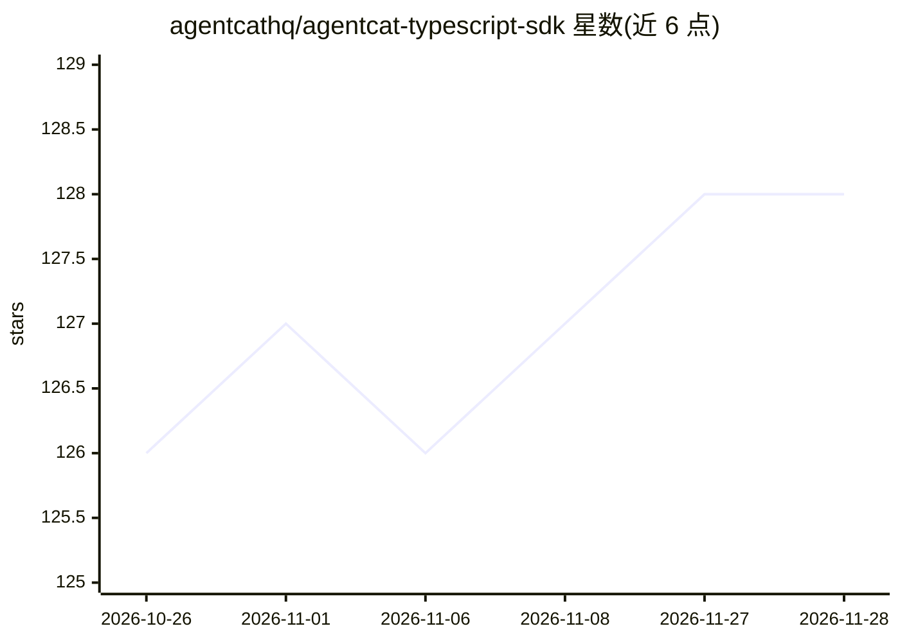

# agentcathq/agentcat-typescript-sdk

⭐ 128 · TypeScript · MIT · 推送 2026-11-26 · [GitHub](https://github.com/agentcathq/agentcat-typescript-sdk) · [官网](https://agentcat.com) · 组织维护

**MCP 服务器所有者的行为分析 SDK：记录 agent 会话与意图**

以 TypeScript SDK 形式嵌入 MCP 服务器的分析中间件：调用 track() 后向工具 schema 注入 session_id、agent_id、context 等参数，将相关工具调用归组为任务并采集 agent 意图；提供会话回放、跨部署调试与未找到功能的检测。同时可将日志、追踪、错误遥测转发至 OpenTelemetry collector 或 Datadog、Sentry、PostHog。内置敏感键掩码与自定义脱敏钩子，诊断信号可经环境变量关闭。需在 agentcat.com 注册获取 project ID。

## 筛选速览

| 维度 | 判定 | 备注 |
|---|---|---|
| AI 角色 | `ai-ecosystem` | LLM/agent 周边工具 |
| 许可风险 | `permissive` | MIT |
| 部署形态 | `library` | 以包/库形式分发 |
| 模型依赖 | — | README 未给出锁定关系 |
| 硬件要求 | — | 无带数字的原话,不猜 |
| 安装摩擦 | `low` | 无编译、无系统依赖或容器化 |
| 成熟度 | — | 结构信号不足 |

## 能力要点

- 通过注入 session_id/agent_id/context 采集 agent 会话与意图数据
- 遥测数据转发至 OpenTelemetry、Datadog、Sentry、PostHog
- 内置敏感键掩码及 redactSensitiveInformation/redactEvent 自定义脱敏钩子
- 开源 MCP 服务器可申请免费使用分析平台

## 适用场景

- 了解用户 agent 在 MCP 服务器上的使用路径与卡点
- 排查 LLM 被工具 API 混淆导致的调用失败
- 从真实使用中发现缺失的工具与功能
- 为既有可观测性平台补齐 MCP 服务器的日志与追踪

## 场景标签

`LLM 可观测性` · 领域:评测与运维

## 证据(README 行号)

> L29: AgentCat is an analytics platform for MCP server owners 🐱. It captures user intentions and behavior patterns to hel
> L41: AgentCat helps builders of MCP servers, Claude Connectors, and ChatGPT Plugins learn how to improve them by capturi
> L53: AgentCat works as a lightweight middleware inside your MCP server. When you call `track()`, it seamlessly modifies 

## 星数曲线

2026-10-26 126 → 2026-11-28 128（+2）

---
*卡片 v1 · prompt 1.4 · 生成 2026-11-28 · 置信度 high · 依据 README sha `c43e58e792bf` · [字段定义](../../DATASET.md)*
