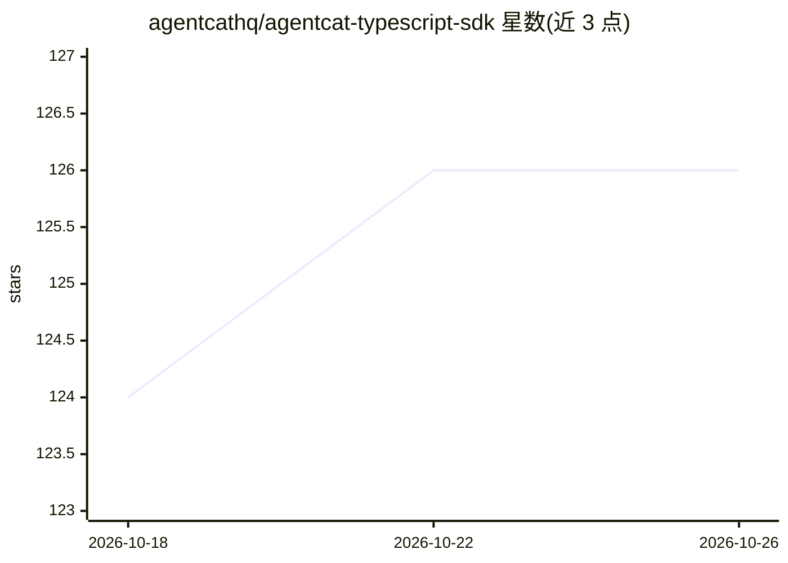

# agentcathq/agentcat-typescript-sdk

⭐ 126 · TypeScript · MIT · 推送 2026-10-24 · [GitHub](https://github.com/agentcathq/agentcat-typescript-sdk) · [官网](https://agentcat.com) · 组织维护

**MCP 服务器分析平台 SDK：追踪 agent 会话与遥测**

面向 MCP 服务器开发者的 TypeScript SDK，作为轻量中间件嵌入服务器：调用 track() 修改工具 schema，注入 session_id、context、get_more_tools 等参数，把相关工具调用按任务分组并捕获 agent 意图数据，发送至 AgentCat 仪表盘做会话回放与调试。同时支持将日志、追踪与错误转发到 OpenTelemetry、Datadog、Sentry、PostHog 等平台。提供数据脱敏钩子、identify 用户识别（不增加工具调用延迟）、匿名诊断信号（可关闭）。开源 MCP 项目可免费使用全部分析平台。需注册账号获取项目 ID。

## 筛选速览

| 维度 | 判定 | 备注 |
|---|---|---|
| AI 角色 | `ai-ecosystem` | LLM/agent 周边工具 |
| 许可风险 | `permissive` | MIT |
| 部署形态 | `library` | 以包/库形式分发 |
| 模型依赖 | — | README 未给出锁定关系 |
| 硬件要求 | — | 无带数字的原话,不猜 |
| 安装摩擦 | `low` | 无编译、无系统依赖或容器化 |
| 成熟度 | — | 结构信号不足 |

## 能力要点

- 注入 session_id/context/get_more_tools 等参数实现 agent 意图捕获与工具调用分组
- 会话回放与跨部署的 trace 调试
- 遥测转发至 OpenTelemetry/Datadog/Sentry/PostHog，可仅转发遥测（projectId 为 null）
- redactSensitiveInformation 与 redactEvent 数据脱敏钩子，数据静态加密

## 适用场景

- 查看用户与其 agent 如何使用我的 MCP 服务器、卡在了哪里
- 发现 agent 在找但服务器缺失的功能
- 为现有 MCP 服务器接入日志与追踪而无需自行实现遥测

## 场景标签

`LLM 可观测性` · 领域:评测与运维

## 证据(README 行号)

> L29: AgentCat is an analytics platform for MCP server owners 🐱. It captures user intentions and behavior patterns to hel
> L41: AgentCat helps builders of MCP servers, Claude Connectors, and ChatGPT Plugins learn how to improve them by capturi
> L53: AgentCat works as a lightweight middleware inside your MCP server. When you call `track()`, it seamlessly modifies 

## 星数曲线

2026-10-18 124 → 2026-10-26 126（+2）

---
*卡片 v1 · prompt 1.4 · 生成 2026-10-23 · 置信度 high · 依据 README sha `f6e62c3d03ee` · [字段定义](../../DATASET.md)*
