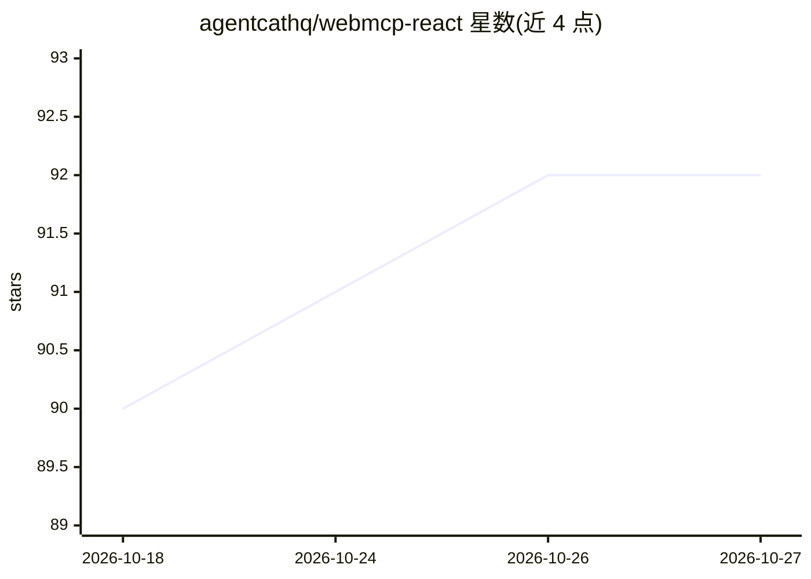

# agentcathq/webmcp-react

⭐ 92 · TypeScript · MIT · 推送 2026-10-23 · [GitHub](https://github.com/agentcathq/webmcp-react) · 组织维护

**让 React 应用把功能暴露为 WebMCP 工具供 AI agent 调用的 hooks 库**

面向 Web 开发者的 React hooks 库，将应用功能注册为 W3C WebMCP 规范定义的 document.modelContext 上的类型化工具，供 WebMCP 兼容 agent（如 Codex）发现和调用；无原生支持的环境自动安装 polyfill。输入用 Zod 定义并带类型推断，也可直接传 JSON Schema；支持 SSR（Next.js/Remix）、Strict Mode、执行状态、AbortSignal 取消、回调、annotations 与动态注册。无法直接访问该 API 的客户端（Claude Code、Cursor）可经 WebMCP Bridge 扩展桥接。npm 安装。

## 筛选速览

| 维度 | 判定 | 备注 |
|---|---|---|
| AI 角色 | `ai-ecosystem` | LLM/agent 周边工具 |
| 许可风险 | `permissive` | MIT |
| 部署形态 | `library` | 以包/库形式分发 |
| 模型依赖 | — | README 未给出锁定关系 |
| 硬件要求 | — | 无带数字的原话,不猜 |
| 安装摩擦 | `low` | 无编译、无系统依赖或容器化 |
| 成熟度 | — | 结构信号不足 |

## 能力要点

- useMcpTool 将工具注册到 document.modelContext，agent 可发现并调用
- 无原生支持时自动安装轻量 polyfill，并逐版跟踪 Chrome 原生行为
- Zod-first 定义输入并获类型推断，亦支持原始 JSON Schema
- SSR 安全（Next.js/Remix）、Strict Mode 安全、每次执行独立 AbortSignal

## 适用场景

- 让自己的网页应用功能被 AI agent（Codex、MCP 客户端等）直接调用
- 在服务端渲染的 Next.js/Remix 应用中注册 WebMCP 工具
- 为可被 agent 操作的工具标注 readOnly/consequential 等行为提示

## 场景标签

 · 领域:Web 前端开发/AI agent 集成

## 证据(README 行号)

> L3: React hooks for exposing typed tools on `document.modelContext`, aligned with the current WebMCP specification.
> L67: This library provides the React bindings for that API. `<WebMCPProvider>` installs a polyfill when native support i
> L73: Agents with built-in WebMCP browser support, such as Codex, discover and call tools directly from the page. Clients

## 星数曲线

2026-10-18 90 → 2026-10-27 92（+2）

---
*卡片 v1 · prompt 1.4 · 生成 2026-10-23 · 置信度 high · 依据 README sha `86e45579522c` · [字段定义](../../DATASET.md)*
