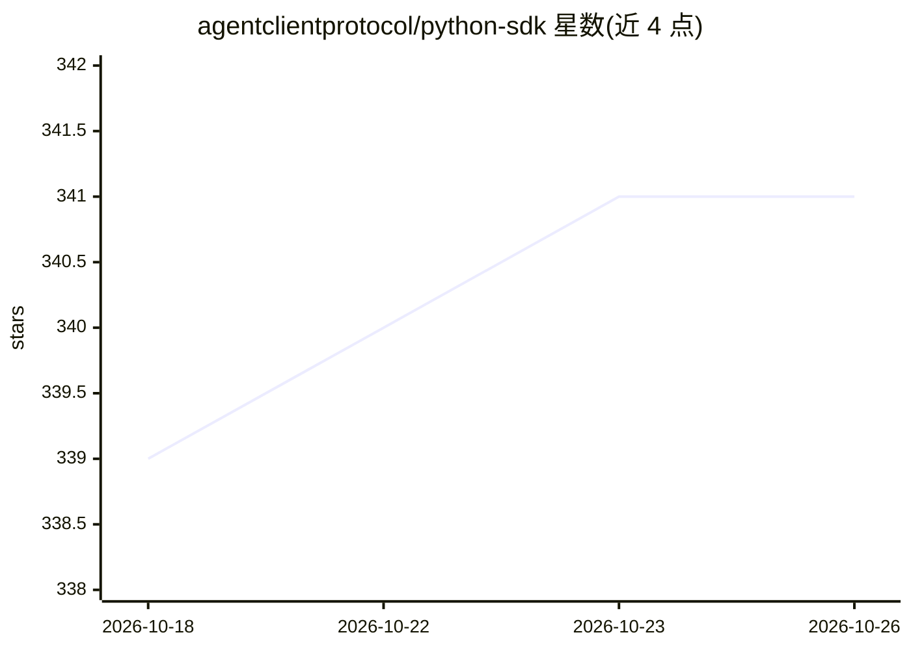

# agentclientprotocol/python-sdk

⭐ 341 · Python · Apache-2.0 · 推送 2026-10-22 · [GitHub](https://github.com/agentclientprotocol/python-sdk) · [官网](https://agentclientprotocol.github.io/python-sdk/) · 组织维护

**Agent Client Protocol 的 Python SDK：构建 ACP 客户端与 agent**

面向 Agent Client Protocol (ACP) 的 Python SDK，提供随上游 ACP schema 生成并同步更新的 Pydantic 模型（acp.schema）、asyncio 基类与 stdio JSON-RPC 传输层、生命周期辅助方法，以及会话累积器、工具调用追踪器、权限代理等 contrib 工具。附带流式、权限、Gemini bridge 与 duet 等可运行示例。适用人群为需要类型化模型与事件流的 agent 作者、在 Python 应用中嵌入 ACP 端点的客户端集成方及工具团队。README 提及 kimi-cli 等采用者。

## 筛选速览

| 维度 | 判定 | 备注 |
|---|---|---|
| AI 角色 | `ai-ecosystem` | LLM/agent 周边工具 |
| 许可风险 | `permissive` | Apache-2.0 |
| 部署形态 | `library` | 以包/库形式分发 |
| 模型依赖 | — | README 未给出锁定关系 |
| 硬件要求 | — | 无带数字的原话,不猜 |
| 安装摩擦 | `medium` | 含编译或系统依赖之一 |
| 成熟度 | — | 结构信号不足 |

## 能力要点

- 随上游 ACP schema 生成并同步的 Pydantic 模型
- asyncio 基类与 stdio JSON-RPC 传输层
- 会话累积器、工具调用追踪器、权限代理等 contrib 工具
- 提供流式、权限、Gemini bridge 等可运行示例

## 适用场景

- 用 Python 实现 ACP 兼容的 agent 或客户端
- 在 Python 应用中嵌入 ACP 通信或包装现有 CLI
- 实验权限流程与流式交互而不重写传输层

## 场景标签

`Agent 框架` · 领域:Agent 开发

## 证据(README 行号)

> L7: Build ACP-compliant agents and clients in Python with generated schema models, asyncio transports, and runnable demo
> L21: - **Spec parity:** Generated Pydantic models in `acp.schema` track every ACP release so payloads stay valid.

## 星数曲线

2026-10-18 339 → 2026-10-26 341（+2）

---
*卡片 v1 · prompt 1.4 · 生成 2026-10-21 · 置信度 high · 依据 README sha `e3b7a4d90732` · [字段定义](../../DATASET.md)*
