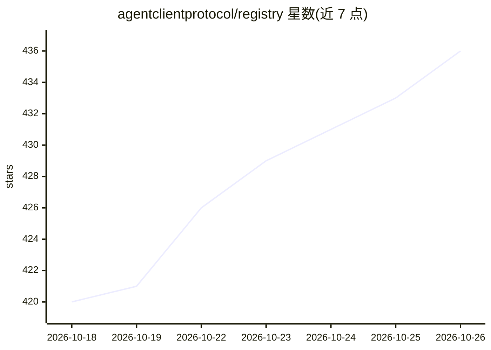

# agentclientprotocol/registry

⭐ 436 · Apache-2.0 · 推送 2026-10-25 · [GitHub](https://github.com/agentclientprotocol/registry) · [官网](https://agentclientprotocol.com/registry) · 组织维护

**实现 ACP 协议的 AI agent 官方注册表清单**

Agent Client Protocol (ACP) 的 agent 注册表仓库，维护一份经过 CI 验证、支持用户认证并返回有效 authMethods 的精选 agent 列表。通过 CDN 以 JSON 索引分发（通用索引及 JetBrains 专用/preview/Air 变体），每小时 cron 自动检查 npm、PyPI、GitHub releases 更新 agent 版本并提交到 main。贡献新 agent 需遵循 CONTRIBUTING.md，格式规范见 FORMAT.md。Apache 2.0 许可。

## 筛选速览

| 维度 | 判定 | 备注 |
|---|---|---|
| AI 角色 | `ai-knowledge` | 知识聚合/清单类 |
| 许可风险 | `permissive` | Apache-2.0 |
| 部署形态 | `library` | 以包/库形式分发 |
| 模型依赖 | — | README 未给出锁定关系 |
| 硬件要求 | — | 无带数字的原话,不猜 |
| 安装摩擦 | `low` | 无编译、无系统依赖或容器化 |
| 成熟度 | — | 结构信号不足 |

## 能力要点

- CI 验证 agent 在 ACP 握手中返回有效 authMethods
- 通过 CDN 分发 registry.json 及 JetBrains 专用/preview/Air 索引
- 每小时 cron 自动从 npm/PyPI/GitHub releases 更新版本

## 适用场景

- IDE 或客户端按索引发现和接入支持 ACP 的 agent
- 查找经过认证验证、支持用户认证的 agent 列表
- 为自己的 agent 提交收录到 ACP 官方注册表

## 场景标签

`精选清单` · 领域:学习与行业

## 证据(README 行号)

> L5: Registry of agents implementing the Agent Client Protocol, ACP.
> L10: > All agents are verified via CI to ensure they return valid `authMethods` in the ACP handshake.

## 星数曲线

2026-10-18 420 → 2026-10-26 436（+16）

---
*卡片 v1 · prompt 1.4 · 生成 2026-10-21 · 置信度 mid · 依据 README sha `3074c0937f59` · [字段定义](../../DATASET.md)*
