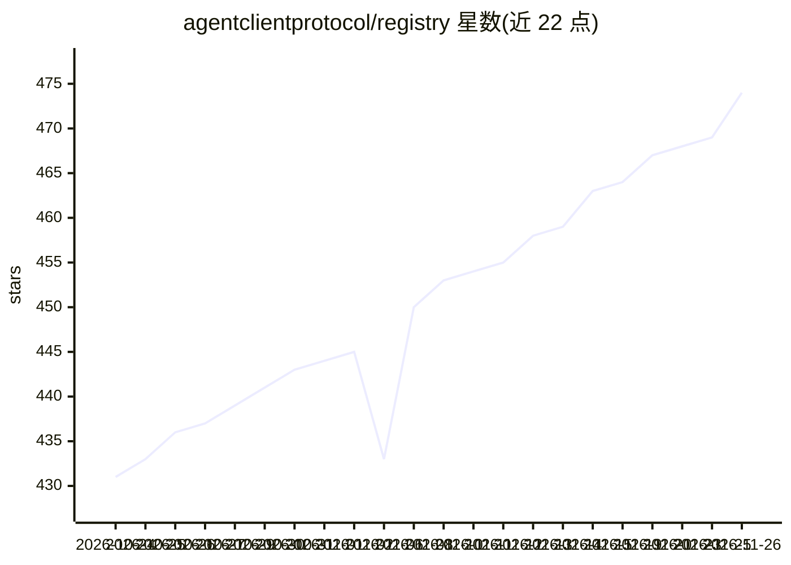

# agentclientprotocol/registry

⭐ 474 · Apache-2.0 · 推送 2026-11-25 · [GitHub](https://github.com/agentclientprotocol/registry) · [官网](https://agentclientprotocol.com/registry) · 组织维护

**实现 ACP 协议的 agent 注册表，供客户端发现可用 agent**

维护一份实现 Agent Client Protocol (ACP) 的 agent 清单，收录支持用户认证的 agent，并通过 CI 验证其在 ACP 握手中返回有效 authMethods。提供公共 JSON 索引端点供拉取，为 JetBrains IDE 提供专用索引及可选预览通道（含稳定版兜底逻辑）。版本通过每小时运行的 cron 任务自动检查 npm、PyPI、GitHub releases 的发布并提交更新。收录新 agent 需按 CONTRIBUTING.md 流程操作。

## 筛选速览

| 维度 | 判定 | 备注 |
|---|---|---|
| AI 角色 | `ai-knowledge` | 知识聚合/清单类 |
| 许可风险 | `permissive` | Apache-2.0 |
| 部署形态 | `library` | 以包/库形式分发 |
| 模型依赖 | — | README 未给出锁定关系 |
| 硬件要求 | — | 无带数字的原话,不猜 |
| 安装摩擦 | `low` | 无编译、无系统依赖或容器化 |
| 成熟度 | — | 结构信号不足 |

## 能力要点

- 收录支持用户认证并通过 CI 验证 authMethods 的 ACP agent
- 提供 registry.json 公共索引端点供客户端拉取
- JetBrains 专用索引与预览通道（含 stable 版兜底）
- cron 任务每小时自动更新 agent 版本（npm/PyPI/GitHub releases）

## 适用场景

- 为支持 ACP 的客户端查找可接入的 agent
- JetBrains IDE 中配置可用的 ACP agent 索引
- 开发者按流程提交自己实现的 ACP agent

## 场景标签

`精选清单` · 领域:学习与行业

## 证据(README 行号)

> L7: Registry of agents implementing the Agent Client Protocol, ACP.
> L9: > **Authentication Required**: This registry maintains a curated list of **agents that support user authentication**
> L35: ## Registry Format

## 星数曲线

2026-10-24 431 → 2026-11-26 474（+43）

---
*卡片 v1 · prompt 1.4 · 生成 2026-11-25 · 置信度 mid · 依据 README sha `36a2477b26b4` · [字段定义](../../DATASET.md)*
