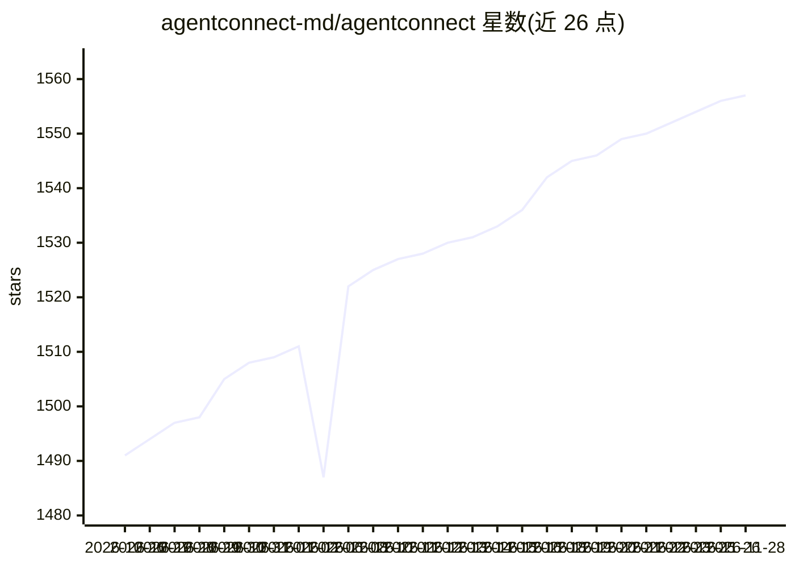

# agentconnect-md/agentconnect

⭐ 1,557 · TypeScript · Apache-2.0 · 推送 2026-11-27 · [GitHub](https://github.com/agentconnect-md/agentconnect) · [官网](https://www.agentconnect.md) · 组织维护

**让 AI 代理团队接入 Slack/GitHub 等平台协同工作的开源平台**

开源多代理协作平台，将 Claude Code、Codex、DeepSeek 等 ACP 兼容代理接入 Slack、Teams、Telegram、微信等消息平台及 GitHub、GitLab、Linear 等工作系统。用户给每个代理分配角色，人与代理在共享会话中协作，代理可互相调用并保留记忆；通过 Jev 做代理路由与模型选择，支持定时任务、webhook 触发、权限边界与知识发布。架构分 Daemon、Relay、Control Plane 三层，支持自托管。

## 筛选速览

| 维度 | 判定 | 备注 |
|---|---|---|
| AI 角色 | `ai-ecosystem` | LLM/agent 周边工具 |
| 许可风险 | `permissive` | Apache-2.0 |
| 部署形态 | `self-host` | docker 或自建部署 |
| 模型依赖 | — | README 未给出锁定关系 |
| 硬件要求 | — | 无带数字的原话,不猜 |
| 安装摩擦 | `low` | 无编译、无系统依赖或容器化 |
| 成熟度 | — | 结构信号不足 |

## 能力要点

- 支持 Slack/Teams/Telegram/微信/QQ 等 20+ 消息与代码平台的代理接入
- 多代理可在共享会话中互相调用并携带记忆与技能
- 通过 Jev 的 Decisions 机制决定代理响应时机、路由与运行时/模型选择
- Daemon/Relay/Control Plane 架构支持 Docker Compose 与 Kubernetes Helm 自托管

## 适用场景

- 在 Slack/Telegram 共享会话中让人与多个 AI 代理一起分诊和处理 issue
- 为 GitHub 新 PR 按角色配置多个代码审查代理（架构/安全等）
- 通过定时任务或 webhook 启动自动化运维流程并保留人工决策环节
- 在受信任的工作区之间跨平台流转支持工单

## 场景标签

`多智能体` `编码 Agent` `代码审查` · 领域:Agent 开发

## 证据(README 行号)

> L68: AgentConnect is an open-source platform where teams and multiple AI agents work
> L71: Linear, and email. Bring Claude Code, Codex, Grok Build, DeepSeek, Pi, or any ACP-compatible
> L73: for agent routing and model selection.

## 星数曲线

2026-10-26 1,491 → 2026-11-28 1,557（+66）

---
*卡片 v1 · prompt 1.4 · 生成 2026-11-26 · 置信度 high · 依据 README sha `8b7ff18f7b99` · [字段定义](../../DATASET.md)*
