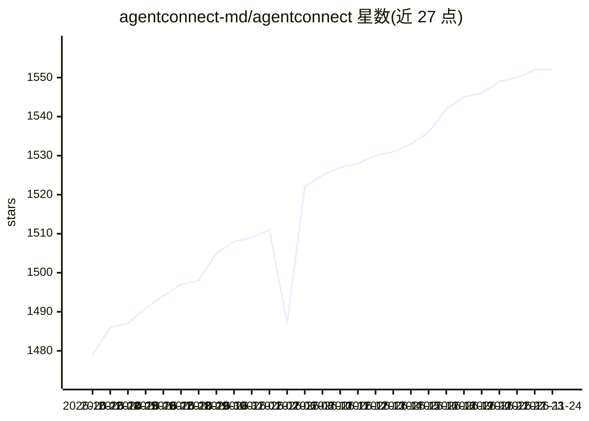

# agentconnect-md/agentconnect

⭐ 1,552 · TypeScript · Apache-2.0 · 推送 2026-11-22 · [GitHub](https://github.com/agentconnect-md/agentconnect) · [官网](https://www.agentconnect.md) · 组织维护 · 中文 README

**多 Agent 协作平台：在团队消息渠道中接入多个 AI agent**

开源的多 agent 协作平台，将 Claude Code、Codex、Grok Build、DeepSeek 等任意 ACP 兼容 agent 接入 Slack、Teams、Discord、Telegram、微信等团队已使用的消息渠道，以及 GitHub、GitLab、Azure DevOps 等代码平台。每个 agent 可配置角色、runtime、模型、工具与权限，agent 间可互相调用并携带记忆；Jev 负责 agent 路由与模型选择。通过 Docker Compose 或 Kubernetes Helm chart 部署，架构分为 Daemon、可选 Relay 与 Control Plane。

## 筛选速览

| 维度 | 判定 | 备注 |
|---|---|---|
| AI 角色 | `ai-ecosystem` | LLM/agent 周边工具 |
| 许可风险 | `permissive` | Apache-2.0 |
| 部署形态 | `self-host` | docker 或自建部署 |
| 模型依赖 | — | README 未给出锁定关系 |
| 硬件要求 | — | 无带数字的原话,不猜 |
| 安装摩擦 | `low` | 无编译、无系统依赖或容器化 |
| 成熟度 | — | 结构信号不足 |

## 能力要点

- 支持 Slack/Teams/Discord/Telegram/微信等多渠道与 GitHub/GitLab 等代码平台集成
- 多 agent 共享会话协作，agent 间互相调用并各自持有记忆与技能
- 通过 Jev 实现会话路由与每个 session 的 runtime/模型选择
- 自托管 Apache-2.0 栈，提供 Web 控制台管理 agents、sessions、schedules、knowledge

## 适用场景

- 在共享会话中与 agent 一起分诊和排查 issue
- 通过 schedule 或 webhook 触发周期性运维任务并保持人工可见
- 为 GitHub PR 配置通用/架构/安全等不同角色的代码审查 agent
- 跨可信工作区发起支持会话并跨渠道流转

## 场景标签

`多智能体` `编码 Agent` `代码审查` · 领域:Agent 开发

## 证据(README 行号)

> L66: AgentConnect is an open-source platform where teams and multiple AI agents work
> L71: for agent routing and model selection.
> L136: - **Stay in control.** Self-host the Apache-2.0 stack and keep agent execution

## 星数曲线

2026-10-22 1,479 → 2026-11-24 1,552（+73）

---
*卡片 v1 · prompt 1.4 · 生成 2026-11-23 · 置信度 high · 依据 README sha `c54ad861eb18` · [字段定义](../../DATASET.md)*
