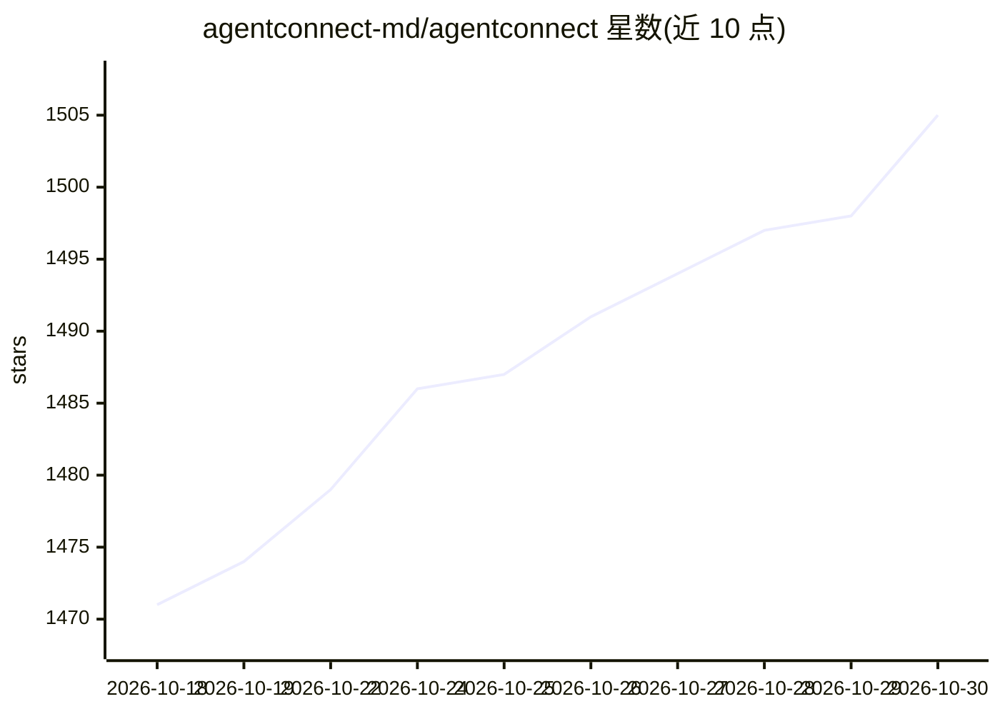

# agentconnect-md/agentconnect

⭐ 1,505 · TypeScript · Apache-2.0 · 推送 2026-10-29 · [GitHub](https://github.com/agentconnect-md/agentconnect) · [官网](https://www.agentconnect.md) · 组织维护 · 中文 README

**让多 AI agent 接入团队聊天与代码平台的协作平台**

开源多 agent 协作平台（Apache 2.0），自称 Claude Tag 的替代。把 Claude Code、Codex、Grok Build、DeepSeek、Pi 等 ACP 兼容 agent 接入 Slack、Telegram、Discord、GitHub、GitLab、Linear 等团队已有渠道，人与 agent 在共享会话中协作；用 Jev 做 agent 路由与模型选择，支持 agent 记忆、知识库、权限边界与自托管部署。提供 Docker Compose 与 Kubernetes Helm chart 安装，架构含 Daemon、Relay 与 Control Plane。

## 筛选速览

| 维度 | 判定 | 备注 |
|---|---|---|
| AI 角色 | `ai-ecosystem` | LLM/agent 周边工具 |
| 许可风险 | `permissive` | Apache-2.0 |
| 部署形态 | `self-host` | docker 或自建部署 |
| 模型依赖 | — | README 未给出锁定关系 |
| 硬件要求 | — | 无带数字的原话,不猜 |
| 安装摩擦 | `low` | 无编译、无系统依赖或容器化 |
| 成熟度 | — | 结构信号不足 |

## 能力要点

- 接入 Slack/Telegram/Discord/GitHub/GitLab/Linear 等 10+ 平台
- 支持 Claude Code、Codex、Grok Build、DeepSeek 等 ACP 兼容运行时
- Jev 驱动的 agent 路由、运行时与模型选择
- Docker Compose 与 Helm chart 自托管部署

## 适用场景

- 在团队聊天频道中让人与多个 AI agent 协作处理 issue
- 定时或 webhook 触发的周期性运维工作
- 为 GitHub PR 定制化 agent 代码审查
- 私有环境中自托管整套 agent 运行平台

## 场景标签

`多智能体` `代码审查` · 领域:Agent 开发

## 证据(README 行号)

> L61: AgentConnect is an open-source platform where teams and multiple AI agents work
> L64: ACP-compatible agent into the conversations and workflows your team already has
> L130: - **Stay in control.** Self-host the Apache-2.0 stack and keep agent execution

## 星数曲线

2026-10-18 1,471 → 2026-10-30 1,505（+34）

---
*卡片 v1 · prompt 1.4 · 生成 2026-10-21 · 置信度 high · 依据 README sha `0ccc737aa9d4` · [字段定义](../../DATASET.md)*
