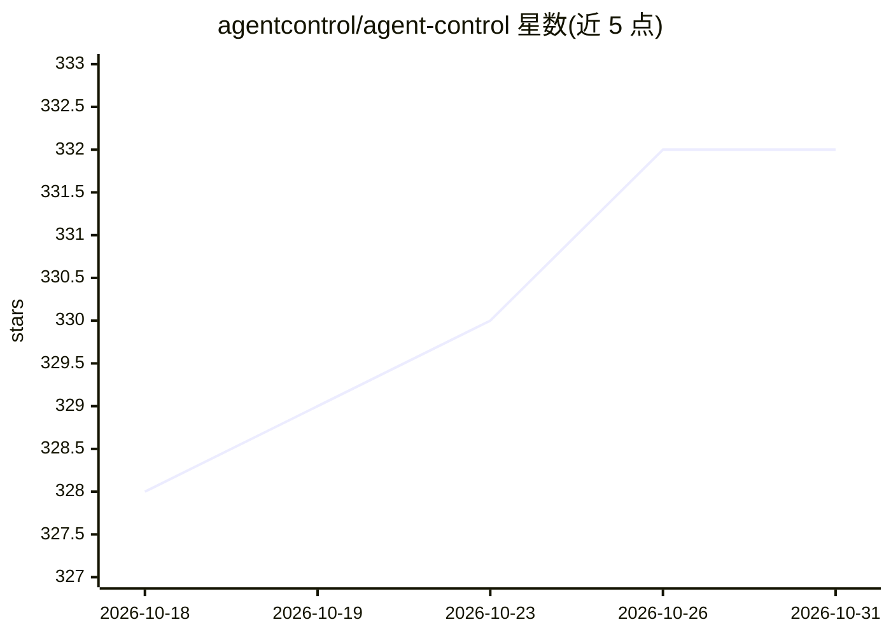

# agentcontrol/agent-control

⭐ 332 · Python · Apache-2.0 · 推送 2026-10-29 · [GitHub](https://github.com/agentcontrol/agent-control) · [官网](https://agentcontrol.dev) · 组织维护

**给多 Agent 系统的集中式运行时护栏控制平面**

Agent Control 是一个集中式安全控制层：在不修改 agent 代码的前提下，按可配置规则评估 agent 的输入与输出，阻断提示注入、PII 泄露等风险。控制规则通过 API 或 UI 在运行时管理，无需重新部署；内置正则、列表、JSON、SQL 等评估器并支持自定义，条件支持 and/or/not 组合树。面向需要跨多个 agent 统一治理的团队。部署方式为 Docker Compose 启动服务端（含 PostgreSQL 与 UI 仪表盘），agent 侧通过 Python/TypeScript SDK 接入，提供 LangChain、CrewAI、Google ADK、AWS Strands 等框架示例，并内置 OpenTelemetry 可观测性 sink。Apache 2.0 许可。

## 筛选速览

| 维度 | 判定 | 备注 |
|---|---|---|
| AI 角色 | `ai-ecosystem` | LLM/agent 周边工具 |
| 许可风险 | `permissive` | Apache-2.0 |
| 部署形态 | `self-host` | docker 或自建部署 |
| 模型依赖 | — | README 未给出锁定关系 |
| 硬件要求 | — | 无带数字的原话,不猜 |
| 安装摩擦 | `low` | 无编译、无系统依赖或容器化 |
| 成熟度 | — | 结构信号不足 |

## 能力要点

- 控制规则集中定义、跨 agent 应用，运行时经 API/UI 更新无需重新部署
- 可插拔评估器（regex/list/JSON/SQL）与 and/or/not 组合条件树
- Docker Compose 一键启动服务端（含 UI），agent 侧 SDK 包裹调用即接入
- 内置 OpenTelemetry sink，控制事件可导出到 OTLP 端点

## 适用场景

- 跨多个 agent 统一配置提示注入与 PII 泄露防护
- 在 UI 中热更新护栏规则而不改动 agent 代码
- 为 SQL agent 阻断危险查询、对工具调用做 deny/steer 决策
- 将控制执行事件接入 OpenTelemetry 做审计观测

## 场景标签

`网络安全` · 领域:学习与行业

## 证据(README 行号)

> L27: Enforce runtime guardrails through a centralized control layer—configure once and apply across all agents. Agent Co
> L31: - **Centralized safety** - define controls once, apply across agents, update without redeploying
> L33: - **Pluggable evaluators** - built-in (regex, list, JSON, SQL) or bring your own

## 星数曲线

2026-10-18 328 → 2026-10-31 332（+4）

---
*卡片 v1 · prompt 1.4 · 生成 2026-10-22 · 置信度 high · 依据 README sha `00ec911efa84` · [字段定义](../../DATASET.md)*
