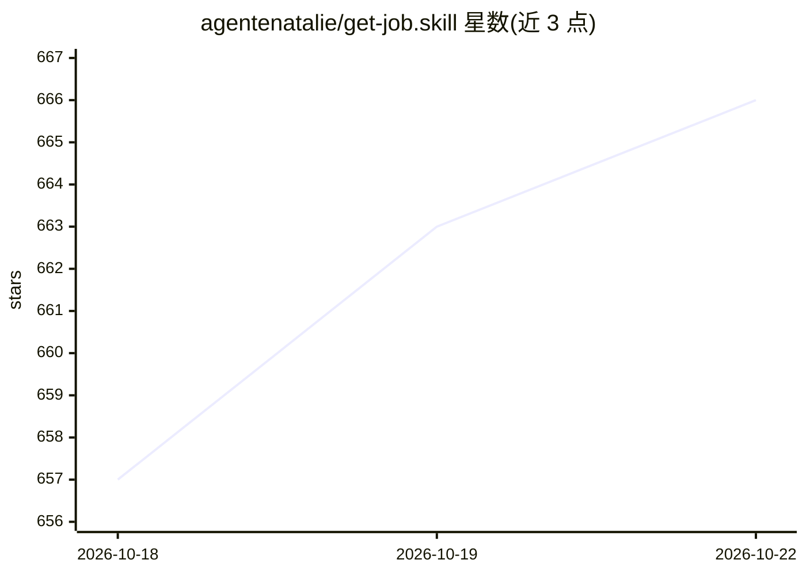

# agentenatalie/get-job.skill

⭐ 675 · Python · NOASSERTION · 推送 2026-08-31 · [GitHub](https://github.com/agentenatalie/get-job.skill) · 个人维护 · 中文 README

**求职全流程 agent skill：岗位调研、简历改写、面试准备**

遵循 Agent Skills 协议（SKILL.md）的技能包，在 Claude Code、Codex、Cursor、OpenClaw 等 runtime 中运行。输入简历与目标岗位后自动走三步：按目标市场调研岗位（WebSearch+来源分级）、按 JD 反向定位改写简历（生成 docx）、生成分轮次逐 bullet 的面试准备材料。设有输入体检（缺失信息自动补齐或降级标注）与交付前质量闸门（P0/P1/P2 覆盖矩阵检查）。声明'翻译不造假'原则，背调红线信息不改。面向求职者，提供 npx 一键安装与手动克隆两种方式，也可仅作参考资料。

## 筛选速览

| 维度 | 判定 | 备注 |
|---|---|---|
| AI 角色 | `ai-native` | 本体是模型或模型工具 |
| 许可风险 | `none` | NOASSERTION |
| 部署形态 | `library` | 以包/库形式分发 |
| 模型依赖 | — | README 未给出锁定关系 |
| 硬件要求 | — | 无带数字的原话,不猜 |
| 安装摩擦 | `low` | 无编译、无系统依赖或容器化 |
| 成熟度 | — | 结构信号不足 |

## 能力要点

- 三段链路：岗位调研 → 简历改写 → 分轮次面试准备，每段产出为下一段输入
- 输入体检：缺 JD/轮次不明/简历不全时自动补齐或降级标注，不编造信息
- 交付前质量闸门：检查来源覆盖、JD 匹配、claim 证据等级、标签泄漏
- 兼容多 runtime（Agent Skills 协议），含 examples/ 完整示例成品

## 适用场景

- 把真实背景翻译成目标岗位语言的简历改写
- 按实际轮次准备逐 bullet 面试讲解与追问应对
- 目标岗位的能力关键词与隐性门槛调研

## 场景标签

`AI 写作` · 领域:内容生成

## 证据(README 行号)

> L95: ├── SKILL.md                      # 三段链路主流程（skill runtime 读这个）
> L123: 基于开放的 Agent Skills 协议，可在 Claude Code、Codex、Cursor、OpenClaw 等兼容 runtime 中运行。

## 星数曲线

2026-10-18 657 → 2026-10-22 666（+9）

---
*卡片 v1 · prompt 1.4 · 生成 2026-10-21 · 置信度 high · 依据 README sha `78a6b87abca9` · [字段定义](../../DATASET.md)*
