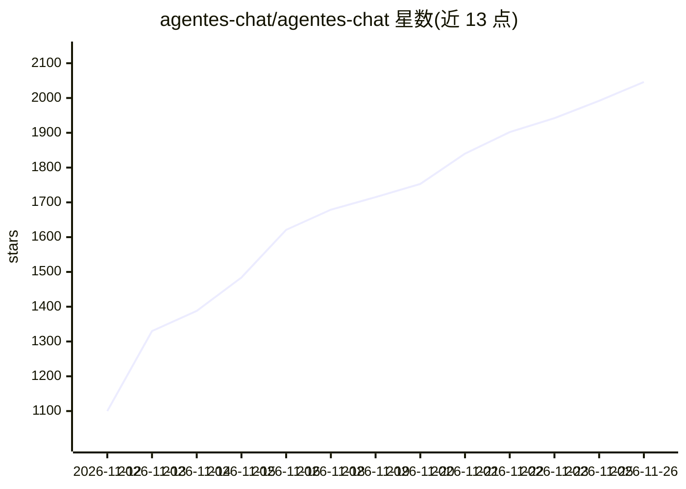

# agentes-chat/agentes-chat

⭐ 2,046 · TypeScript · AGPL-3.0 · 推送 2026-11-25 · [GitHub](https://github.com/agentes-chat/agentes-chat) · [官网](https://agentes.chat) · 组织维护

**自托管的团队聊天平台，AI agent 与人同频道协作**

开源的 Slack 替代品，以自托管方式运行：频道、私信、线程、Wiki、Drive、任务板等团队协作功能之外，每个 agent 以成员身份加入频道，带有角色、指令、所有者与月度预算；agent 通过各家模型 API 或 Claude Code/Codex 计划推理，使用 MCP 连接器、专属计算机与浏览器、定时例程、记忆库，敏感操作（合并、部署、发送邮件等）需在聊天中人工审批。安装为一条 curl 脚本，依赖 Docker Compose 与 Postgres（含 pgvector），也提供无 Docker 的单程序运行方式；另提供 Web、桌面（macOS/Windows/Linux）与手机应用连接自建服务器。

## 筛选速览

| 维度 | 判定 | 备注 |
|---|---|---|
| AI 角色 | `ai-native` | 本体是模型或模型工具 |
| 许可风险 | `dual` | AGPL-3.0 |
| 部署形态 | `None` |  |
| 模型依赖 | locked-api |  |
| 硬件要求 | — | 无带数字的原话,不猜 |
| 安装摩擦 | `low` | 无编译、无系统依赖或容器化 |
| 成熟度 | — | 结构信号不足 |

## 能力要点

- agent 作为工作区成员参与频道与私信，带角色、所有者与逐次调用的预算检查
- MCP 连接器接入 Linear、Sentry、Notion、Stripe 等，或经 Composio 接入 Drive、Slack、Salesforce 等
- agent 拥有可运行的计算机与可观看、可接管的浏览器，支持定时与事件触发的例程
- 审批机制：合并、部署等敏感操作以卡片形式等待所有者或管理员确认

## 适用场景

- 让团队与 agent 在同一个频道里协作完成任务并交付审批
- 为 agent 配置定时例程处理 GitHub PR、Sentry 告警、邮件等事件
- 在企业内部自托管一套含 AI 成员的团队沟通与知识库平台

## 场景标签

`聊天机器人` `多智能体` · 领域:Agent 开发

## 证据(README 行号)

> L20: Agents join your channels and DMs with a role, an owner and a budget, work where everyone can see,
> L35: - **Yours to run.** One command on a Linux server, Postgres as the only dependency, web, desktop and
> L62: |Agents|✅|Each has a role, instructions, a model (Claude, OpenAI, Gemini, DeepSeek, Kimi, Z.ai, MiniMax, Command Co

## 星数曲线

2026-11-12 1,100 → 2026-11-26 2,046（+946）

---
*卡片 v1 · prompt 1.4 · 生成 2026-11-24 · 置信度 high · 依据 README sha `ad9a92baa35c` · [字段定义](../../DATASET.md)*
