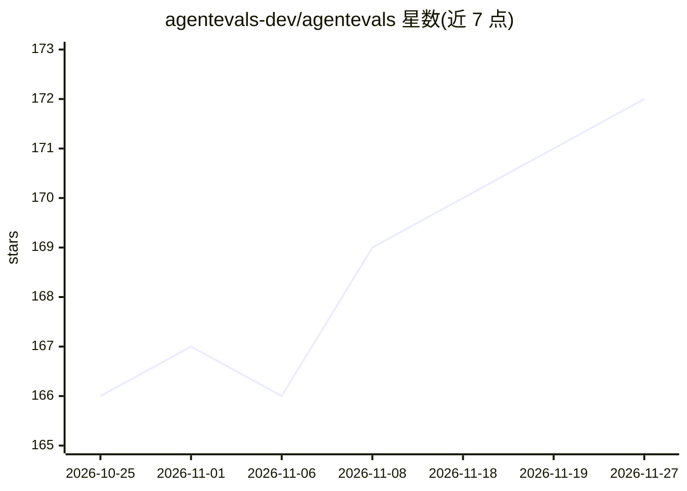

# agentevals-dev/agentevals

⭐ 172 · Python · Apache-2.0 · 推送 2026-11-24 · [GitHub](https://github.com/agentevals-dev/agentevals) · [官网](https://aevals.ai/) · 组织维护

**基于 OpenTelemetry 遥测为 agent 行为打分的评测工具**

agentevals 接收 agent 已产出的 OpenTelemetry OTLP 遥测（HTTP/gRPC、实时或文件），将 GenAI span 与日志事件解析为轮次、工具调用、token 与回答，对黄金评测集打分，结果以 gen_ai.evaluation.result 事件回传管道。评分读取已录制遥测，不需重跑 agent、不消耗 agent token。提供 CLI（CI 用）、Web UI、REST/gRPC API、MCP server 与 Helm chart；内置工具轨迹与响应匹配判定、LLM judge 与 rubric，可自定义任意语言的 evaluator。项目处于活跃开发期，README 声明可能有破坏性变更。

## 筛选速览

| 维度 | 判定 | 备注 |
|---|---|---|
| AI 角色 | `ai-ecosystem` | LLM/agent 周边工具 |
| 许可风险 | `permissive` | Apache-2.0 |
| 部署形态 | `self-host` | docker 或自建部署 |
| 模型依赖 | local-ok | 支持本地模型 |
| 硬件要求 | — | 无带数字的原话,不猜 |
| 安装摩擦 | `low` | 无编译、无系统依赖或容器化 |
| 成熟度 | `idea` | |

## 能力要点

- 从既有 OTLP 遥测评分，无需 SDK 重跑 agent
- 确定性指标（工具轨迹/响应匹配）与 LLM judge、rubric、自定义 evaluator
- CLI 离线评分、Web UI 检查、MCP server、gRPC API 与 Helm/Kubernetes 部署
- 结果以 gen_ai.evaluation.result 事件回传原管道

## 适用场景

- 在 CI 中对 trace 文件评分，用退出码门控部署
- 不重跑 agent、不耗 token 地重复评测同一 run
- 在 Web UI 实时查看 live session 的工具调用并打分
- 把评测结果作为 OTel 事件接入现有可观测管道

## 场景标签

`模型评测` · 领域:评测与运维

## 证据(README 行号)

> L22: agentevals scores AI agent behavior from the OpenTelemetry telemetry your agent already produces. It is an OTLP des
> L27: * **Gates and judges.** Tool trajectory and response matching for deterministic pass/fail, LLM judges and rubrics f

## 星数曲线

2026-10-25 166 → 2026-11-27 172（+6）

---
*卡片 v1 · prompt 1.4 · 生成 2026-11-27 · 置信度 high · 依据 README sha `028ef02e25bc` · [字段定义](../../DATASET.md)*
