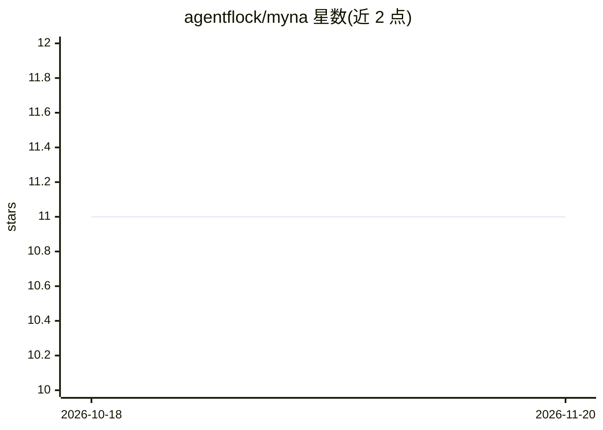

# agentflock/myna

⭐ 11 · JavaScript · MIT · 推送 2026-06-25 · [GitHub](https://github.com/agentflock/myna) · 组织维护

**工程管理者的本地 AI 幕僚：会议、邮件、项目知识库一体管理**

以 Claude Code 插件形式安装的 agent，内含 31 个面向技术从业者日常的技能：生成每日简报、会议准备、收件箱分类、项目与人员 brief、草拟回复与状态更新、多角色文档评审。通过 MCP 读取邮件、Slack 与日历，把项目、人员、会议、决策、待办以纯 markdown 写入本地 vault，会话间持续积累上下文。仅草拟不发送，数据不出本机；不确定事项进入持久 review queue 由用户处置。

## 筛选速览

| 维度 | 判定 | 备注 |
|---|---|---|
| AI 角色 | `ai-native` | 本体是模型或模型工具 |
| 许可风险 | `permissive` | MIT |
| 部署形态 | `None` |  |
| 模型依赖 | locked-api |  |
| 硬件要求 | — | 无带数字的原话,不猜 |
| 安装摩擦 | `low` | 无编译、无系统依赖或容器化 |
| 成熟度 | — | 结构信号不足 |

## 能力要点

- 31 个任务技能，自然语言输入自动路由
- 本地 markdown 知识库，跨会话积累项目与人员上下文
- 通过 MCP 连接邮件、Slack、日历，复用企业已批准的服务器
- 草拟不发送、只写单个本地文件夹、11 人设文档评审

## 适用场景

- 每天生成包含会议与待办的晨间简报
- 1:1 前自动生成准备材料、会后提取任务与决策
- 把杂乱收件箱分类并草拟回复
- 从贡献记录汇编季度绩效叙述与 brag doc

## 场景标签

`AI 助手` `知识库管理` · 领域:对话与助手

## 证据(README 行号)

> L6: AI Chief of Staff for tech professionals — your projects, your team, your meetings, your email, all running locally 
> L26: Myna is a Claude Code agent with **31 skills** for the work that fills your week: it preps your meetings, triages y
> L52: /plugin marketplace add agentflock/plugins

## 星数曲线

2026-10-18 11 → 2026-11-20 11（+0）

---
*卡片 v1 · prompt 1.4 · 生成 2026-11-18 · 置信度 high · 依据 README sha `8a2c24e9870c` · [字段定义](../../DATASET.md)*
