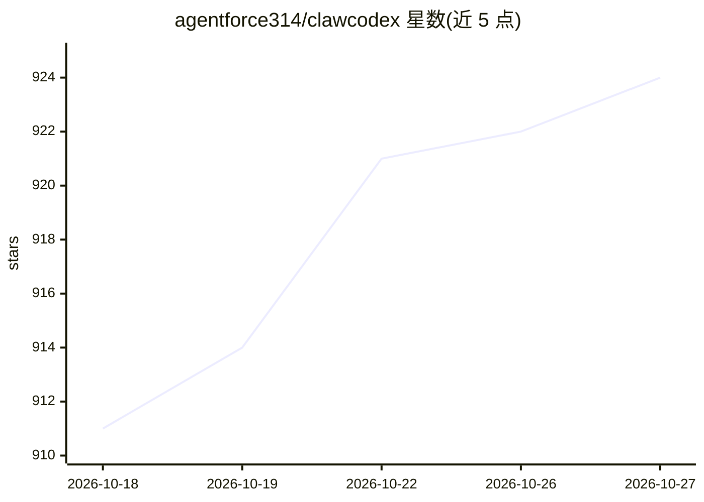

# agentforce314/clawcodex

⭐ 924 · TypeScript · MIT · 推送 2026-10-21 · [GitHub](https://github.com/agentforce314/clawcodex) · [官网](https://clawcodex.app) · 个人维护

**Claude Code 的 Python 重写版：终端 AI 编程代理**

用 Python 重写的 CLI AI 编程代理，移植自 Claude Code 的 TypeScript 参考实现。提供多代理团队（常驻 teammate、共享任务板、会话级 supervisor 管理所有子代理）、/eco token 压缩（实测 Bash 输出 token 减少 80%）、DeepSeek 前缀缓存适配、--nano 极简模式（约 2K token 固定载荷）。附 Web UI 与 Desktop 应用，共享同一安装、配置与会话存储。通过 DeepSeek 等供应商 API 运行，需配置 API key；Windows 需 Git for Windows。

## 筛选速览

| 维度 | 判定 | 备注 |
|---|---|---|
| AI 角色 | `ai-native` | 本体是模型或模型工具 |
| 许可风险 | `permissive` | MIT |
| 部署形态 | `desktop` | 安装包/桌面程序 |
| 模型依赖 | local-ok | 支持本地模型 |
| 硬件要求 | — | 无带数字的原话,不猜 |
| 安装摩擦 | `low` | 无编译、无系统依赖或容器化 |
| 成熟度 | — | 结构信号不足 |

## 能力要点

- 多代理团队：TeamCreate 建队、常驻 teammate 互发消息、依赖感知任务板、单一 supervisor 管理全部子代理
- /eco token 压缩：27 个真实命令输出实测 92,989→17,767 tokens（-80%）
- DeepSeek 前缀缓存适配：请求前缀保持字节级稳定，跨轮覆盖 system+tools+history
- --nano 模式：约 2K token 固定载荷，Terminal-Bench 2.1 与 pi harness 同分（k=1）

## 适用场景

- 在终端里让 AI 代理完成编程任务，按 token 成本选择供应商
- 组织多个持久 AI teammate 协作处理任务板工作
- 在浏览器或桌面应用中继续 CLI 里开始的会话

## 场景标签

`编码 Agent` `多智能体` · 领域:Agent 开发

## 证据(README 行号)

> L5: **A production-oriented Python rebuild of Claude Code — real architecture, reliable CLI agent**
> L97: clawcodex login   # interactive provider + API key setup → ~/.clawcodex/config.json
> L98: clawcodex         # start it in any project — Full Access by default, /permissions to change

## 星数曲线

2026-10-18 911 → 2026-10-27 924（+13）

---
*卡片 v1 · prompt 1.4 · 生成 2026-10-21 · 置信度 mid · 依据 README sha `fb600bc22dd9` · [字段定义](../../DATASET.md)*
