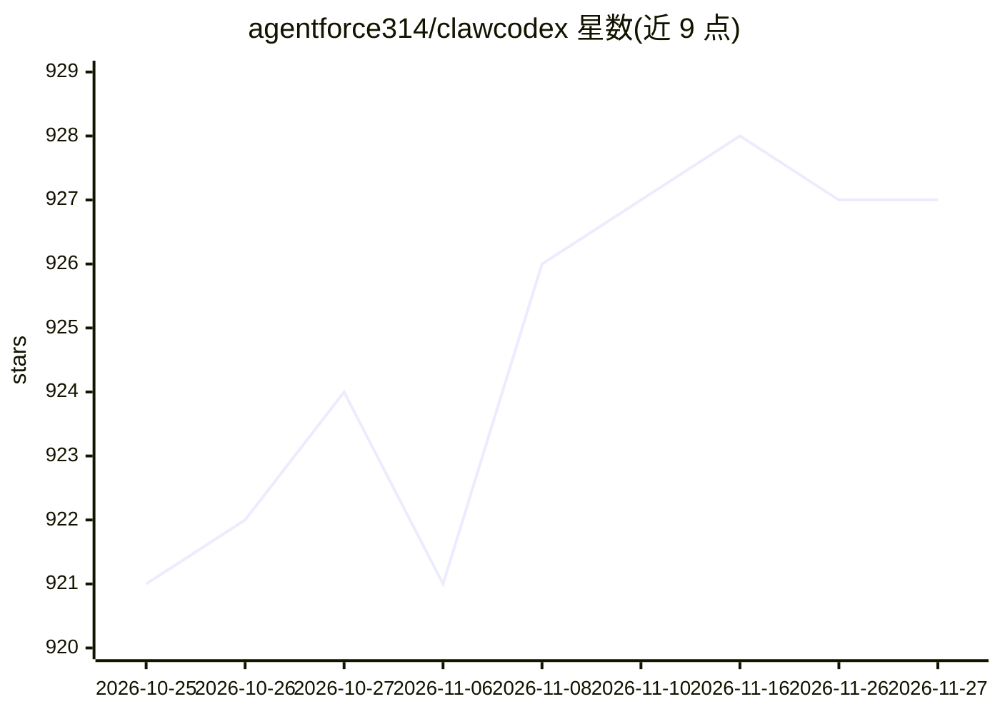

# agentforce314/clawcodex

⭐ 927 · TypeScript · MIT · 推送 2026-11-08 · [GitHub](https://github.com/agentforce314/clawcodex) · [官网](https://clawcodex.app) · 个人维护

**Claude Code 的 Python 重建版：面向开发者的终端编码 Agent**

以 Python 3.10+ 重写的终端编码 Agent，从 TypeScript 参考实现移植，通过 CLI/Web UI/桌面端读取、编辑代码并运行测试。关键机制包括：多 Agent 团队（TeamCreate 命名队友、共享任务板、会话级 supervisor）、/eco 令牌压缩（声称减少 Bash 输出令牌）、DeepSeek 前缀缓存配合、--nano 最小模式（约 2K 令牌固定载荷）。安装需配置 provider 与 API key；Windows 需 Git for Windows。附 Terminal-Bench 2.1 自测结果与可复现的 Harbor 适配器。

## 筛选速览

| 维度 | 判定 | 备注 |
|---|---|---|
| AI 角色 | `ai-native` | 本体是模型或模型工具 |
| 许可风险 | `permissive` | MIT |
| 部署形态 | `desktop` | 安装包/桌面程序 |
| 模型依赖 | local-ok | 支持本地模型 |
| 硬件要求 | — | 无带数字的原话,不猜 |
| 安装摩擦 | `low` | 无编译、无系统依赖或容器化 |
| 成熟度 | — | 结构信号不足 |

## 能力要点

- 多 Agent 团队：持久化队友、共享任务板与会话级 supervisor
- /eco 令牌压缩管道，有损输出 tee 到磁盘可恢复
- DeepSeek 前缀缓存配合，保持请求前缀字节稳定
- --nano 最小 harness（6 工具、约 2K 令牌载荷）与 Web UI 三栏界面

## 适用场景

- 在终端里让 Agent 读写代码、跑测试并汇报结果
- 长会话编码时压缩令牌与利用缓存降低成本
- 用命名队友拆分任务并在共享任务板上协作

## 场景标签

`编码 Agent` `多智能体` · 领域:Agent 开发

## 证据(README 行号)

> L5: **A production-oriented Python rebuild of Claude Code — real architecture, reliable CLI agent**
> L100: clawcodex         # start it in any project — Full Access by default, /permissions to change

## 星数曲线

2026-10-25 921 → 2026-11-27 927（+6）

---
*卡片 v1 · prompt 1.4 · 生成 2026-11-25 · 置信度 mid · 依据 README sha `628358049a4a` · [字段定义](../../DATASET.md)*
