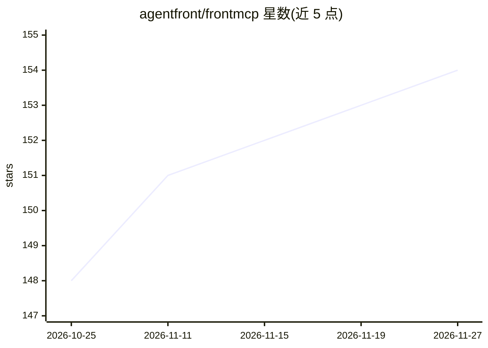

# agentfront/frontmcp

⭐ 154 · TypeScript · Apache-2.0 · 推送 2026-11-26 · [GitHub](https://github.com/agentfront/frontmcp) · [官网](https://frontmcp.dev) · 组织维护

**TypeScript 框架：构建含认证与测试的 MCP 服务器**

FrontMCP 提供 TypeScript 框架，开发者以带 Zod schema 的类型化类编写 MCP 的 tools、resources 与 prompts，框架负责传输、依赖注入、会话、认证与执行流程。支持 MCP 2026-07-28 及更早版本，同一服务器可在本地与生产环境运行，部署目标覆盖 Node.js、Vercel、AWS Lambda 和 Cloudflare Workers。提供 CLI（create/init/dev/build/test/inspector）与多个扩展包（auth、testing、adapters、observability 等），并有官方插件生态与在线 playground。要求 Node 24+，采用 Apache-2.0 许可。

## 筛选速览

| 维度 | 判定 | 备注 |
|---|---|---|
| AI 角色 | `ai-ecosystem` | LLM/agent 周边工具 |
| 许可风险 | `permissive` | Apache-2.0 |
| 部署形态 | `library` | 以包/库形式分发 |
| 模型依赖 | — | README 未给出锁定关系 |
| 硬件要求 | — | 无带数字的原话,不猜 |
| 安装摩擦 | `low` | 无编译、无系统依赖或容器化 |
| 成熟度 | — | 结构信号不足 |

## 能力要点

- 用类型化类 + Zod schema 编写 MCP tools/resources/prompts
- 内置认证（OAuth/JWKS/DCR）、E2E 测试框架与依赖注入
- 部署目标覆盖 Node.js、Vercel、AWS Lambda、Cloudflare Workers
- 提供 CLI 脚手架、多官方插件与浏览器 playground

## 适用场景

- 为企业内部 API 构建 MCP 工具服务端
- 将 MCP 服务器部署到 Serverless 平台
- 为 MCP 工具添加认证、限流与人工审批门

## 场景标签

 · 领域:LLM 基础设施/MCP 框架

## 证据(README 行号)

> L18: **FrontMCP is the TypeScript framework for MCP servers.** You write tools, resources and prompts as typed classes w
> L44: [TypeScript MCP server frameworks for production][docs-compare] puts FrontMCP next to [the official TypeScript SDK]

## 星数曲线

2026-10-25 148 → 2026-11-27 154（+6）

---
*卡片 v1 · prompt 1.4 · 生成 2026-11-27 · 置信度 high · 依据 README sha `16ba2adaa8dc` · [字段定义](../../DATASET.md)*
