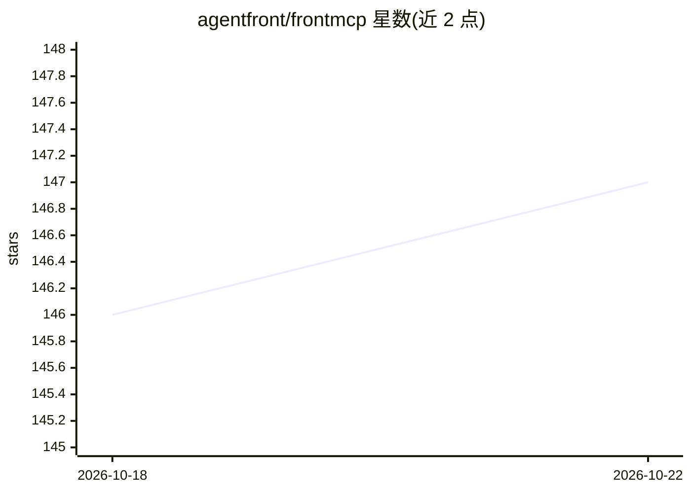

# agentfront/frontmcp

⭐ 147 · TypeScript · Apache-2.0 · 推送 2026-10-21 · [GitHub](https://github.com/agentfront/frontmcp) · [官网](https://frontmcp.dev) · 组织维护

**TypeScript 的 MCP 服务器开发框架：类型化工具、DI、认证与多平台部署**

面向 TypeScript 开发者的 Model Context Protocol 服务器框架：以 Zod 类型化的类编写 tools、resources 与 prompts，框架负责传输、依赖注入、会话、认证与执行流程；同一服务器可在本地与生产环境不改代码运行。支持 Node、Vercel、AWS Lambda 与 Cloudflare Workers 部署，提供 MCP 2026-07-28 无状态修订版及更早版本。附带 CLI、E2E 测试框架、OpenAPI 生成工具、React 客户端、观测性与十余个官方插件，Apache-2.0 许可。

## 筛选速览

| 维度 | 判定 | 备注 |
|---|---|---|
| AI 角色 | `ai-ecosystem` | LLM/agent 周边工具 |
| 许可风险 | `permissive` | Apache-2.0 |
| 部署形态 | `library` | 以包/库形式分发 |
| 模型依赖 | — | README 未给出锁定关系 |
| 硬件要求 | — | 无带数字的原话,不猜 |
| 安装摩擦 | `low` | 无编译、无系统依赖或容器化 |
| 成熟度 | — | 结构信号不足 |

## 能力要点

- Zod 类型化类编写 tools/resources/prompts，框架处理传输、DI、会话与认证
- 同一服务器可在 Node、Vercel、AWS Lambda、Cloudflare Workers 上运行
- CLI 覆盖 create/init/dev/build/test/inspector 流程
- 十余个官方插件：缓存、人审门控、限流、仪表盘、WebMCP 等

## 适用场景

- 用 TypeScript 快速搭建并部署 MCP 服务器
- 为现有 API（OpenAPI spec）生成 MCP 工具
- 在 Serverless 平台上运行带认证与观测性的 MCP 服务

## 场景标签

`Agent 框架` · 领域:Agent 开发

## 证据(README 行号)

> L18: **FrontMCP is the TypeScript framework for MCP servers.** You write tools, resources and prompts as typed classes w
> L51: |`@frontmcp/sdk`|Core framework: decorators, DI, flows, transport, MCP protocol|

## 星数曲线

2026-10-18 146 → 2026-10-22 147（+1）

---
*卡片 v1 · prompt 1.4 · 生成 2026-10-22 · 置信度 high · 依据 README sha `0689ee9a0c0b` · [字段定义](../../DATASET.md)*
