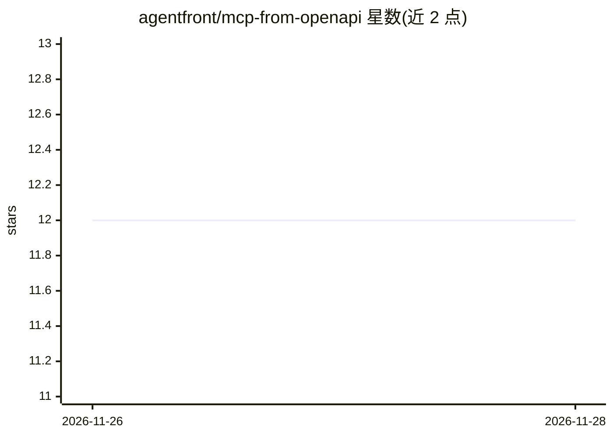

# agentfront/mcp-from-openapi

⭐ 12 · TypeScript · Apache-2.0 · 推送 2026-11-25 · [GitHub](https://github.com/agentfront/mcp-from-openapi) · [官网](https://www.npmjs.com/package/mcp-from-openapi) · 组织维护

**把 OpenAPI/Swagger 规范转换为 MCP 工具定义的 TypeScript 库**

将 Swagger 2.0 与 OpenAPI 3.0/3.1/3.2 规范转换为 MCP 工具定义的 TypeScript 库。核心机制包括：自动解决 path/query/body 间的同名参数冲突并生成显式请求映射器；内置 buildHttpRequest() 按完整 OpenAPI 序列化表组装 HTTP 请求；按 claude/openai/gemini/strict 四种目标输出各客户端可接受的 schema；另提供 token 预算估算、Overlay 应用、lint、x-mcp 扩展及 SSRF 防护。以 npm 包发布，要求 Node.js >= 22.19.0 与 zod@4 peer 依赖。

## 筛选速览

| 维度 | 判定 | 备注 |
|---|---|---|
| AI 角色 | `ai-ecosystem` | LLM/agent 周边工具 |
| 许可风险 | `permissive` | Apache-2.0 |
| 部署形态 | `library` | 以包/库形式分发 |
| 模型依赖 | — | README 未给出锁定关系 |
| 硬件要求 | — | 无带数字的原话,不猜 |
| 安装摩擦 | `low` | 无编译、无系统依赖或容器化 |
| 成熟度 | — | 结构信号不足 |

## 能力要点

- Swagger 2.0 与 OpenAPI 3.0/3.1/3.2 规范转 MCP 工具，含参数冲突自动解决
- buildHttpRequest() 按完整 OpenAPI 序列化表组装请求
- 四种客户端兼容目标（claude/openai/gemini/strict）生成各自接受的 schema
- $ref 解析默认阻止内网 IP、localhost 与云元数据端点

## 适用场景

- 把已有 REST API 的 OpenAPI 规范暴露为 MCP 工具供 agent 调用
- 针对不同 LLM 客户端生成各自兼容的工具 schema
- 在加载不可信 API 规范时防护 SSRF 风险

## 场景标签

 · 领域:LLM 基础设施/MCP 工具链

## 证据(README 行号)

> L3: > Convert Swagger 2.0 and OpenAPI 3.0, 3.1 and 3.2 specifications into MCP tool definitions with automatic parameter
> L43: - **Client Compatibility Targets** -- `target: 'claude' | 'openai' | 'gemini' | 'strict'` emits schemas each client

## 星数曲线

2026-11-26 12 → 2026-11-28 12（+0）

---
*卡片 v1 · prompt 1.4 · 生成 2026-11-26 · 置信度 high · 依据 README sha `e3103b53c4a9` · [字段定义](../../DATASET.md)*
