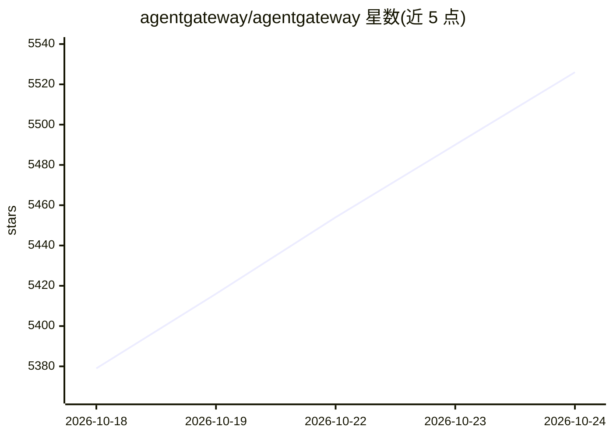

# agentgateway/agentgateway

⭐ 5,526 · Rust · Apache-2.0 · 推送 2026-10-23 · [GitHub](https://github.com/agentgateway/agentgateway) · [官网](https://agentgateway.dev) · 组织维护

**面向 AI Agent 与 MCP 服务的代理网关，Rust 实现**

开源反向代理，基于 MCP 与 A2A 协议，为 agent-to-LLM、agent-to-tool、agent-to-agent 通信提供安全、可观测与治理能力。功能包括：统一 OpenAI 兼容 API 路由到多家 LLM 提供商（含预算与负载均衡）、MCP 网关（工具联邦、多种传输、OAuth）、A2A 网关、基于 Kubernetes Inference Gateway 扩展的自托管模型推理路由、多层护栏（regex/OpenAI moderation/Bedrock Guardrails 等）、认证 RBAC 与 OpenTelemetry。提供 Standalone 与 Kubernetes 两种快速开始路径，内置 UI。给部署与运维 AI agent 流量基础设施的开发者使用。

## 筛选速览

| 维度 | 判定 | 备注 |
|---|---|---|
| AI 角色 | `ai-ecosystem` | LLM/agent 周边工具 |
| 许可风险 | `permissive` | Apache-2.0 |
| 部署形态 | `None` |  |
| 模型依赖 | — | README 未给出锁定关系 |
| 硬件要求 | — | 无带数字的原话,不猜 |
| 安装摩擦 | `low` | 无编译、无系统依赖或容器化 |
| 成熟度 | — | 结构信号不足 |

## 能力要点

- 统一 OpenAI 兼容 API 路由多家 LLM 提供商，含预算控制、负载均衡与故障转移
- MCP 网关：工具联邦、stdio/HTTP/SSE/Streamable HTTP 传输、OpenAPI 集成、OAuth
- A2A 网关支持能力发现、模态协商与任务协作
- 护栏与安全：regex/OpenAI moderation/Bedrock Guardrails/Model Armor、JWT/OAuth、RBAC、OpenTelemetry

## 适用场景

- 统一接入多家 LLM 提供商并控制预算与流量
- 通过 MCP 网关把 LLM 连接到工具与外部数据源
- 在 Kubernetes 上按 GPU 利用率等指标路由到自托管模型
- 为 agent 间通信提供认证、护栏与可观测性

## 场景标签

`模型网关` · 领域:Agent 开发

## 证据(README 行号)

> L22: **Agentgateway** is an open source proxy built on AI-native protocols (MCP & A2A) that provides drop-in security, o
> L34: - **LLM Gateway**

## 星数曲线

2026-10-18 5,379 → 2026-10-24 5,526（+147）

---
*卡片 v1 · prompt 1.4 · 生成 2026-10-20 · 置信度 high · 依据 README sha `0ea11add6de9` · [字段定义](../../DATASET.md)*
