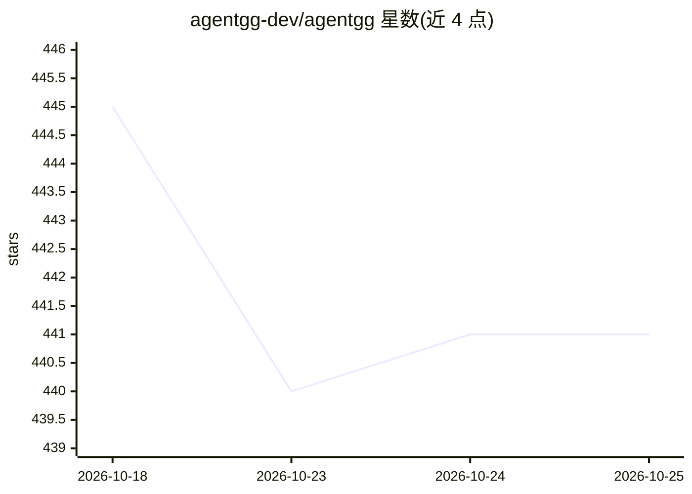

# agentgg-dev/agentgg

⭐ 441 · TypeScript · Apache-2.0 · 推送 2026-10-20 · [GitHub](https://github.com/agentgg-dev/agentgg) · [官网](https://agentgg.dev/) · 组织维护

**给安全工程师的 agentic SAST 扫描器：AI agent 读代码做白盒审计**

基于 AI agent 的静态应用安全测试（SAST）命令行工具：扫描前先做快速 recon 摸清项目结构，随后由 agent 跟随 import、检查调用图，确认后才报告漏洞发现，可扫描整个仓库或 PR diff。扫描输出 markdown 报告，支持中断续扫与本地 web UI 查看结果。需 Node.js 20+ 与至少一个模型提供商账号（Anthropic/OpenAI/Bedrock/Vertex/OpenRouter/Ollama），live-validate 功能另需 Docker。每个 agent 是一个 markdown 文件，首次扫描自动下载 agent 目录，也可从历史事件报告生成自定义 agent。自述处于 beta 阶段，另有托管服务 app.agentgg.dev。

## 筛选速览

| 维度 | 判定 | 备注 |
|---|---|---|
| AI 角色 | `ai-native` | 本体是模型或模型工具 |
| 许可风险 | `permissive` | Apache-2.0 |
| 部署形态 | `library` | 以包/库形式分发 |
| 模型依赖 | local-ok | 支持本地模型 |
| 硬件要求 | — | 无带数字的原话,不猜 |
| 安装摩擦 | `low` | 无编译、无系统依赖或容器化 |
| 成熟度 | `idea` | |

## 能力要点

- agent 跟随 import 与调用图确认漏洞后再报告，非模式匹配
- 支持全仓库扫描与 git diff 的 PR 式扫描
- 中断的扫描可在重跑时恢复，未变更文件自动跳过
- agent 以单个 markdown 文件定义，可从事件报告生成自定义 agent

## 适用场景

- 对整个代码仓库做白盒安全审计
- 在 CI/PR 流程中只扫描变更引入的漏洞
- 把团队的历史安全事件沉淀为可复用的扫描 agent

## 场景标签

`网络安全` · 领域:学习与行业

## 证据(README 行号)

> L7: `agentgg` is an agentic SAST scanner. Its agents read your code and reason about it — they follow imports, check the
> L25: Requires Node.js 20+. You also need an account with one model provider — Anthropic, OpenAI, AWS Bedrock, Google Ver

## 星数曲线

2026-10-18 445 → 2026-10-25 441（-4）

---
*卡片 v1 · prompt 1.4 · 生成 2026-10-22 · 置信度 high · 依据 README sha `30078caab261` · [字段定义](../../DATASET.md)*
