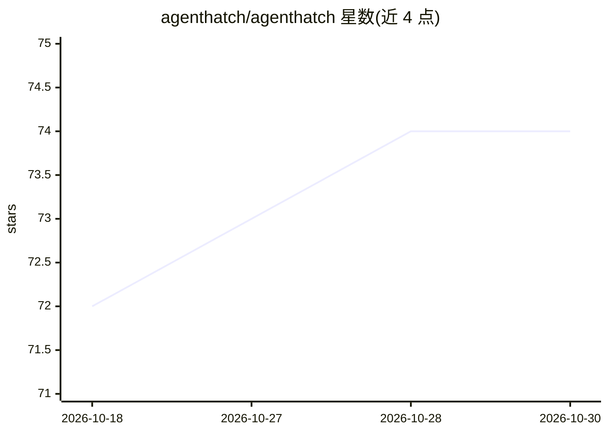

# agenthatch/agenthatch

⭐ 74 · Python · MIT · 推送 2026-10-22 · [GitHub](https://github.com/agenthatch/agenthatch) · 组织维护

**把 SKILL.md 编译为独立可运行 Python AI Agent 的工具**

面向维护多个 SKILL.md 技能文件的开发者的编译器：通过三阶段流水线（确定性解析、6 个 LLM 推理 harness、Jinja2 代码生成）把 SKILL.md 转成带 pyproject.toml、CLI 入口、类型化工具定义与 MCP 集成的独立 Python 包。支持 OpenAI、Anthropic、DeepSeek、Ollama 等多种 LLM 提供方配置；传入参考文件目录时可生成基于 SQLite FTS 的 RAG 知识库 agent。需 Python 3.11+，MIT 许可。

## 筛选速览

| 维度 | 判定 | 备注 |
|---|---|---|
| AI 角色 | `ai-ecosystem` | LLM/agent 周边工具 |
| 许可风险 | `permissive` | MIT |
| 部署形态 | `library` | 以包/库形式分发 |
| 模型依赖 | local-ok | 支持本地模型 |
| 硬件要求 | — | 无带数字的原话,不猜 |
| 安装摩擦 | `low` | 无编译、无系统依赖或容器化 |
| 成熟度 | — | 结构信号不足 |

## 能力要点

- SKILL.md → AHSSPEC 规范 → 独立 Python agent 包的三阶段编译流水线
- 6 个专用 LLM harness 并行推理并交叉校验
- 知识库模式：SQLite FTS 索引 + 生成 retrieve() 工具的 RAG-native agent
- 生成的 agent 采用 6 状态 PlanLayer 规划引擎

## 适用场景

- 把积累的多个 SKILL.md 技能转成独立运行的程序
- 基于自有文档目录生成带引用溯源的问答 agent
- 让技能具备类型化工具定义与自动 MCP 配置

## 场景标签

`代码生成` `RAG` · 领域:编码与开发

## 证据(README 行号)

> L41: agenthatch treats a SKILL.md as **source code** — not a prompt. It compiles it
> L42: through a deterministic pipeline into a standalone Python agent that you can

## 星数曲线

2026-10-18 72 → 2026-10-30 74（+2）

---
*卡片 v1 · prompt 1.4 · 生成 2026-10-24 · 置信度 high · 依据 README sha `6f6b03f0a9a8` · [字段定义](../../DATASET.md)*
