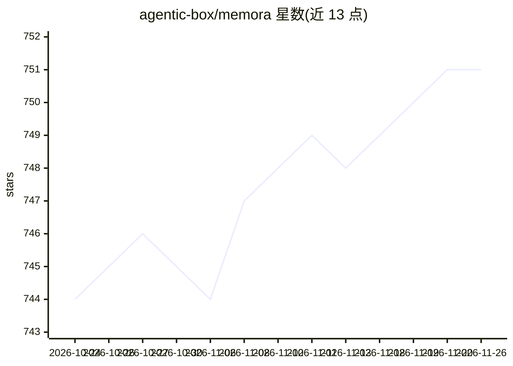

# agentic-box/memora

⭐ 751 · Python · MIT · 推送 2026-11-18 · [GitHub](https://github.com/agentic-box/memora) · 组织维护

**给 AI agent 提供持久集体记忆的 MCP 记忆层**

以 MCP server 形式运行的 agent 记忆层：SQLite 本地存储，可选 S3/R2/D1 云同步，支持多数据库路由。核心机制包括 absorb 流程（LLM 对每条事实判定重复/更新/矛盾/相关/新增并跳过重复）、取代式谱系（更新不删除旧知识，检索默认沿链取最新版）、语义搜索（TF-IDF/sentence-transformers/OpenAI 嵌入）、typed 边的知识图谱与 Mermaid 可视化，并提供 RAG 聊天面板、事件通知与操作历史。通过 pip 安装或容器方式部署为 HTTP 服务，配置进 Claude Code/Codex CLI 使用。

## 筛选速览

| 维度 | 判定 | 备注 |
|---|---|---|
| AI 角色 | `ai-ecosystem` | LLM/agent 周边工具 |
| 许可风险 | `permissive` | MIT |
| 部署形态 | `self-host` | docker 或自建部署 |
| 模型依赖 | — | README 未给出锁定关系 |
| 硬件要求 | — | 无带数字的原话,不猜 |
| 安装摩擦 | `low` | 无编译、无系统依赖或容器化 |
| 成熟度 | — | 结构信号不足 |

## 能力要点

- absorb 流程由 LLM 分类事实（重复/更新/矛盾/相关/新增）并支持 dry_run 预览
- 取代式谱系：更新保留旧版本链，检索默认跟随到当前版
- 语义搜索支持 TF-IDF、sentence-transformers、OpenAI 嵌入与混合检索
- 单进程多数据库路由，一个服务可按 /mcp/<name> 服务多个存储

## 适用场景

- 为多个 agent 会话提供跨会话的持久记忆
- 把文档存为可逐条语义检索的片段树
- 通过图谱界面查看记忆间的关联与聚类
- 多个 agent 之间通过事件通知协作

## 场景标签

`Agent 记忆` `知识图谱` · 领域:Agent 开发

## 证据(README 行号)

> L6: An MCP memory layer for agents: structured storage, semantic retrieval, graph relations, and source-backed cross-ses
> L83: Two paths. **pip** is a local stdio child the client spawns. A **container** is a detached HTTP service you start w
> L165: The server runs automatically when configured in Claude Code. Manual invocation:

## 星数曲线

2026-10-24 744 → 2026-11-26 751（+7）

---
*卡片 v1 · prompt 1.4 · 生成 2026-11-24 · 置信度 mid · 依据 README sha `28b3f02475cc` · [字段定义](../../DATASET.md)*
