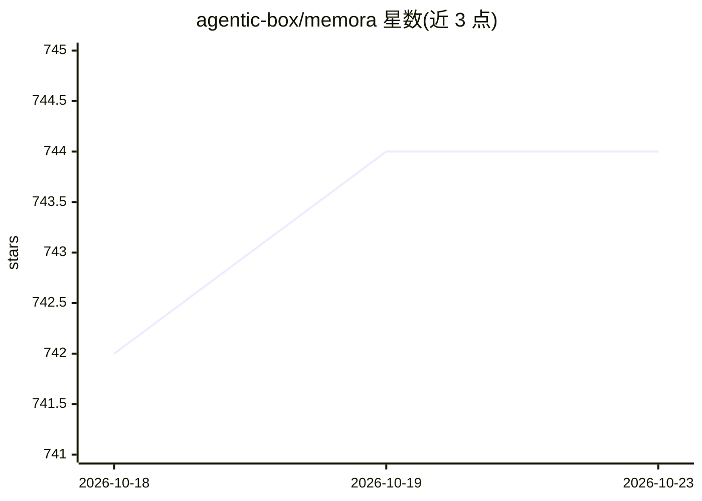

# agentic-box/memora

⭐ 744 · Python · MIT · 推送 2026-10-21 · [GitHub](https://github.com/agentic-box/memora) · 组织维护

**给 AI agent 提供持久共享记忆的 MCP 记忆层服务**

面向 AI agent 的 MCP 记忆服务器：以 SQLite（可选 S3/R2/Cloudflare D1 云同步）持久化存储事实，通过 LLM 分类实现吸收式写入（重复/更新/矛盾判定、去重合并）、更新取代旧知识的世系链、语义检索（TF-IDF/sentence-transformers/OpenAI 嵌入）、类型化边的知识图谱可视化，以及 markdown 文档片段树存储。一个进程可经 /mcp/<name> 路由服务多个存储库，提供 pip 本地 stdio 与容器 HTTP 服务两种安装路径，并给出 Claude Code 与 Codex CLI 的接入配置。容器路径依赖 Apple container CLI（需 Apple silicon + macOS 26）。

## 筛选速览

| 维度 | 判定 | 备注 |
|---|---|---|
| AI 角色 | `ai-ecosystem` | LLM/agent 周边工具 |
| 许可风险 | `permissive` | MIT |
| 部署形态 | `self-host` | docker 或自建部署 |
| 模型依赖 | — | README 未给出锁定关系 |
| 硬件要求 | — | 无带数字的原话,不猜 |
| 安装摩擦 | `low` | 无编译、无系统依赖或容器化 |
| 成熟度 | — | 结构信号不足 |

## 能力要点

- LLM 分类的 Absorb 写入：重复/更新/矛盾/关联判定与去重合并，支持 dry_run 预览
- Supersession 世系链：更新取代而非删除，检索可按 active/latest/full_history 追溯
- 多数据库路由：单进程经 /mcp/<name> 服务多个存储库
- 44 个 MCP 工具可按 full/leader/agent 档位裁剪

## 适用场景

- 让 Claude Code / Codex CLI 等 MCP 客户端跨会话保留和检索工作记忆
- 多个 agent 通过事件通知与共享存储协同积累知识
- 用知识图谱 UI 浏览和检索 agent 沉淀的记忆与文档

## 场景标签

`Agent 记忆` `知识图谱` · 领域:Agent 开发

## 证据(README 行号)

> L6: An MCP memory layer for agents: structured storage, semantic retrieval, graph relations, and source-backed cross-ses
> L142: The server runs automatically when configured in Claude Code. Manual invocation:

## 星数曲线

2026-10-18 742 → 2026-10-23 744（+2）

---
*卡片 v1 · prompt 1.4 · 生成 2026-10-21 · 置信度 mid · 依据 README sha `228908e08b1a` · [字段定义](../../DATASET.md)*
