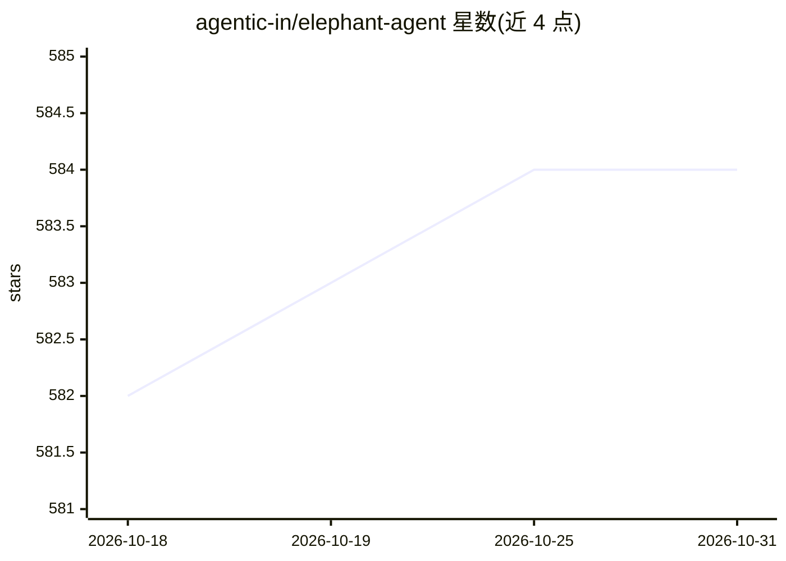

# agentic-in/elephant-agent

⭐ 584 · Python · 推送 2026-08-27 · [GitHub](https://github.com/agentic-in/elephant-agent) · [官网](https://elephant.agentic-in.ai) · 组织维护 · 中文 README

**以个人模型为核心的自进化个人 AI Agent 应用**

面向个人用户的 Agent 产品：围绕使用者构建可纠正的 Personal Model（Identity/World/Pulse/Journey 四个视角），据此设计长周期的 Paths 并拆解为 Steps，在 Checkpoints 交还用户判断，可派出 baby elephants 子代理协作。提供 macOS 桌面应用（推荐）与 Linux/云环境的 CLI + Dashboard 两种形态，集成消息渠道、日历、技能与工具（浏览器/文件系统/MCP），支持本地或托管模型作为 provider。

## 筛选速览

| 维度 | 判定 | 备注 |
|---|---|---|
| AI 角色 | `ai-native` | 本体是模型或模型工具 |
| 许可风险 | `none` | — |
| 部署形态 | `None` |  |
| 模型依赖 | — | README 未给出锁定关系 |
| 硬件要求 | — | 无带数字的原话,不猜 |
| 安装摩擦 | `low` | 无编译、无系统依赖或容器化 |
| 成熟度 | — | 结构信号不足 |

## 能力要点

- 四视角 Personal Model（Identity/World/Pulse/Journey）随交互持续深化
- 将长期方向组织为 Paths/Steps/Checkpoints，可派出子代理（Herd）
- macOS 桌面应用与 Linux/Cloud CLI + Dashboard 两种产品形态
- 集成 WeChat/Feishu/Discord/DingDing/WeCom 消息与日历提醒

## 适用场景

- 让 AI 在长期工作与健康等方向上持续跟进并按检查点征求我的判断
- 查看并纠正 AI 对我的理解（Personal Model）
- 通过消息渠道与 AI 保持日常交互

## 场景标签

`AI 助手` `Agent 记忆` · 领域:Agent 开发

## 证据(README 行号)

> L18: The mother elephant grows a correctable **Personal Model** of who you are, what
> L23: Once Elephant Agent understands enough, it can help design living **Paths**:
> L72: The macOS app is the recommended product surface. Chat / Wake is where you talk

## 星数曲线

2026-10-18 582 → 2026-10-31 584（+2）

---
*卡片 v1 · prompt 1.4 · 生成 2026-10-22 · 置信度 high · 依据 README sha `4bf0b0d237d7` · [字段定义](../../DATASET.md)*
