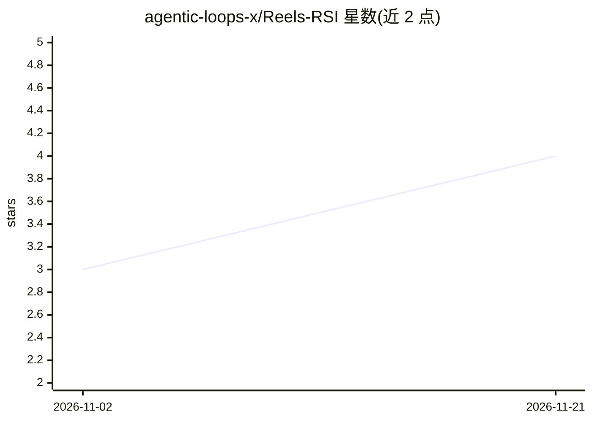

# agentic-loops-x/Reels-RSI

⭐ 4 · TeX · Apache-2.0 · 推送 2026-11-07 · [GitHub](https://github.com/agentic-loops-x/Reels-RSI) · 组织维护 · 中文 README

**开源 AI 短视频导演：一句话生成讲解 reel 并随每次产出自我改进**

以 agent skill 形式运行的短视频生成工具：输入一句话或一篇论文（arXiv/PDF），输出带旁白、字幕、配乐的讲解视频，渲染由代码逐帧驱动。架构分两半：TTS、字幕、字体、地图、渲染、检查是确定性 CLI；脚本、分镜、审查由外部 agent（Claude Code、Codex CLI、Gemini CLI、OpenCode 等）承担。自改进循环分四层：单 reel 评审打分、跨 reel 记忆 lesson、lesson 固化为静态规则、基于基准的 skill 进化（人工门控）。中文优先：逐字 TTS 时间轴、CJK 断行、中英双语字幕、六语言配音。

## 筛选速览

| 维度 | 判定 | 备注 |
|---|---|---|
| AI 角色 | `ai-native` | 本体是模型或模型工具 |
| 许可风险 | `permissive` | Apache-2.0 |
| 部署形态 | `None` |  |
| 模型依赖 | local-ok | 支持本地模型 |
| 硬件要求 | — | 无带数字的原话,不猜 |
| 安装摩擦 | `medium` | 含编译或系统依赖之一 |
| 成熟度 | — | 结构信号不足 |

## 能力要点

- RSI 四层自改进：评审→lessons→规则→基于基准的 skill 进化（train/holdout 投票，人工应用）
- Deterministic CLI + agent 创作半的混合架构，评委与复盘角色接受任意 provider:model
- 论文讲解：八个审稿人问题骨架、三级受众嵌套、storyboard 门禁与 claim→源行溯源
- 中文优先与六语言配音（reels dub），逐字时间轴与字体子集化

## 适用场景

- 给中学生做历史、物理、数学题的讲解短视频
- 把 arXiv 论文转成分级讲解视频（小白/有基础/专业人士）
- 同一课程配音成中日韩英西法多语言版本
- 让 agent 在多次产出中积累规则避免重复犯错

## 场景标签

`视频生成` `语音合成` · 领域:内容生成

## 证据(README 行号)

> L5: One sentence in → a narrated, captioned, scored explainer reel out — rendered from code, directed by
> L19: |🔌 **Any model**|Directing runs in the agent you already use — Claude Code, Codex CLI, Gemini CLI, OpenCode (→ Deep
> L154: The deterministic half (TTS, captions, fonts, music, SFX, maps, assembly, checks, render) is a

## 星数曲线

2026-11-02 3 → 2026-11-21 4（+1）

---
*卡片 v1 · prompt 1.4 · 生成 2026-11-21 · 置信度 high · 依据 README sha `fd8f86417e52` · [字段定义](../../DATASET.md)*
