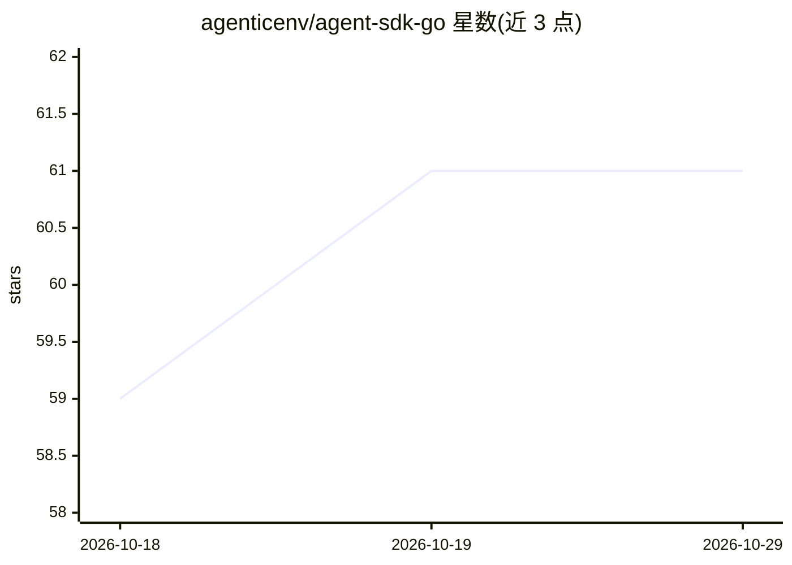

# agenticenv/agent-sdk-go

⭐ 61 · Go · Apache-2.0 · 推送 2026-10-27 · [GitHub](https://github.com/agenticenv/agent-sdk-go) · [官网](https://docs.agenticenv.ai/) · 组织维护

**Go 语言 AI agent 持久化执行 SDK：崩溃后恢复 agent 运行状态**

开源 Go SDK，用于构建具备持久化执行能力的 AI agent：agent 状态、工具调用与执行循环在进程崩溃后可恢复。默认进程内运行、零基础设施，可切换到 Temporal 或 Restate 实现分布式持久执行。核心组件均为可插拔接口，支持多 LLM 提供商（OpenAI/Anthropic/Gemini/DeepSeek/Ollama 及自定义）、MCP 工具、A2A 协议、子 agent、人工审批、RAG、流式输出与 OpenTelemetry 观测。附带 agctl CLI 二进制与示例、评测工具。社区项目，非 Temporal/Restate 官方。

## 筛选速览

| 维度 | 判定 | 备注 |
|---|---|---|
| AI 角色 | `ai-ecosystem` | LLM/agent 周边工具 |
| 许可风险 | `permissive` | Apache-2.0 |
| 部署形态 | `None` |  |
| 模型依赖 | local-ok | 支持本地模型 |
| 硬件要求 | — | 无带数字的原话,不猜 |
| 安装摩擦 | `low` | 无编译、无系统依赖或容器化 |
| 成熟度 | — | 结构信号不足 |

## 能力要点

- 进程崩溃后恢复 agent 状态、工具调用与执行循环，支持流重连
- 进程内零配置运行，或切换 Temporal/Restate 分布式执行
- 核心组件可插拔：LLM、工具、记忆、运行时均可替换
- 支持 MCP、A2A、子 agent、人工审批、预算控制与 Token 用量统计

## 适用场景

- 构建需要跨进程崩溃可靠运行的 Go AI agent
- 通过 A2A/MCP 接入远程 agent 与工具生态
- 分布式多进程部署 agent（Temporal/Restate 后端）
- 对 agent 运行做 Token 预算控制与人工审批

## 场景标签

`Agent 框架` `Agent 记忆` · 领域:Agent 开发

## 证据(README 行号)

> L12: **Open-source Go SDK for building durable AI agents.** Runs in-process with crash-resilient execution via durable-g
> L22: - **LLM providers** — OpenAI, Anthropic, Gemini, DeepSeek, Ollama (local) + custom via `interfaces.LLMClient`

## 星数曲线

2026-10-18 59 → 2026-10-29 61（+2）

---
*卡片 v1 · prompt 1.4 · 生成 2026-10-24 · 置信度 high · 依据 README sha `61de55420abd` · [字段定义](../../DATASET.md)*
